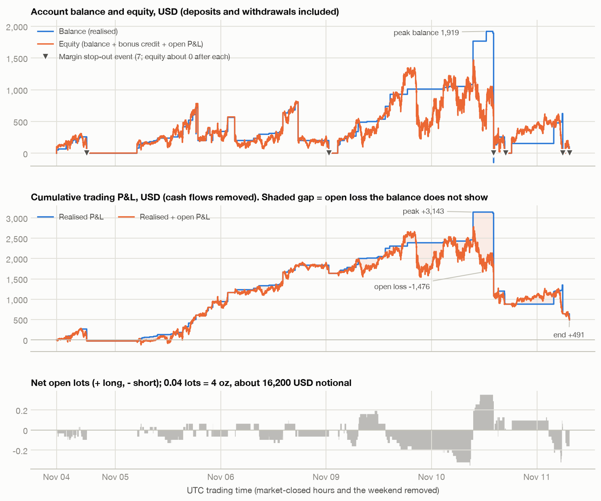
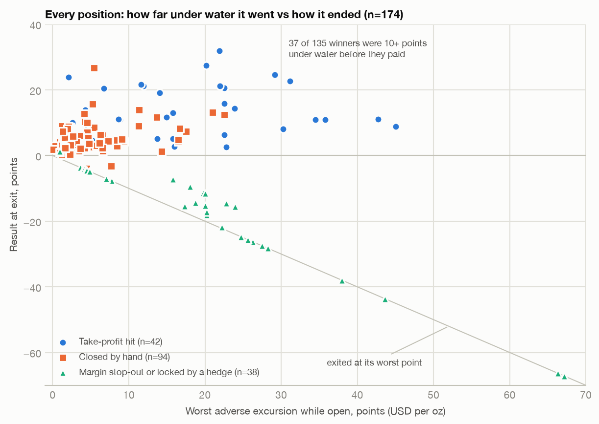

# XM Real — Study 1: performance, account value and risk

XM Global MT5 real account, GOLD (XAUUSD), leverage 1:1000, hedging mode, every order from the MT5 mobile app.
416 deals, 2026-11-04 10:06 to 2026-11-11 07:04 UTC: six trading days (Wed-Fri, Mon-Wed), the account's whole life.
Times are UTC unless marked IST (UTC+5:30). A "point" is 1 USD per oz; 0.04 lots = 4 oz = 4 USD per point.
Every number below is produced by the scripts in this folder; `n` is given wherever a rate or mean is quoted.

## 1. Verdict

**The profit is leverage plus holding losers until they come back. No entry edge is measurable, and the account was
wiped out seven times in six days.**

| # | Question | Answer |
|---|---|---|
| 1 | Is there an entry edge? | **No.** After the 121 entry decisions, price moved (net of spread, in the trade direction) -0.62 pts at 1 min, -0.52 at 5 min, -0.46 at 30 min, -0.82 at 60 min, -0.22 at 4 h. Random entries on the same side within 3 h of each real one (n=4,816) give -0.57, -0.67, -1.17, -1.41, -2.10. With a symmetric 5-pt stop and target the real entries win 41.3% and the random ones 40.7% (3 pts: 37.2 vs 37.1; 12 pts: 45.5 vs 45.1). |
| 2 | Where does the 75.8% win rate come from? | **The exit rule.** Winners are closed small (median +4.70 pts, n=135). Losers are not closed: of 39 losing positions, 33 were closed by the broker's margin stop-out, 4 by a hedge plus close-by, and 2 by hand (-30.26 USD together). Average loss 96.50 USD against average win 31.51 needs a 75.4% win rate to break even. Actual: 75.8%. |
| 3 | Does the profit need the deep holding? | **Yes.** 37 of 135 winners (27.4%) were 10+ pts under water before they paid and supply 45.6% of gross profit; 20 (14.8%) were 20+ pts under and supply 29.5%. Add any hard stop between 3 and 20 pts to the actual trades and the week is -651 to -1,130 USD. It is positive only with a stop of 30 pts or wider. |
| 4 | Is +490.83 USD different from zero? | **No.** 27 flat-to-flat episodes: 20 won (+2,216.06), 7 lost (-1,725.23), every loser ended in a stop-out. Mean +18.18, sd 199.76, t = 0.47. Episode bootstrap 95% CI of the total: -1,633 to +2,417; 31% of resamples are at or below zero. Three days up, three down. |
| 5 | What is the risk? | Median effective leverage 148x equity (p90 293x). The median distance to liquidation was 26.2 pts (p10 13.0) in a week whose median daily range was 93.7 pts. Seven stop-out events (34 deals) cost -3,478.72 USD, 92.4% of gross loss, and each left 2.97 USD of equity or less. |
| 6 | Balance vs equity drawdown | Realised P&L peaked at +3,142.90 (11-10 09:01) and ended at +490.83: 84.4% given back in 22 hours. Max drawdown -2,652.07 on the balance curve, -2,292.38 on the equity curve. While the account was still making highs the balance curve never showed worse than -294.16; the equity curve showed -1,123.44. Open loss peaked at -1,476.33, 81% of the money in the account. |
| 7 | Money in, out, left | In 884.74 USD, out 1,805.00, left 0.00 (plus 2.97 of non-withdrawable credit). Net **+920.26 = +104% of deposits**, made of trading P&L 490.83, bonus credit burnt covering losses 367.71, broker negative-balance resets 11.44, deposit top-ups 50.28. All of it was banked in week 1 (+1,678.20); week 2 lost all 757.94 of fresh deposits. |
| 8 | Lot size | 163 of 178 positions are 0.04 lots and net +2,132.58. The 10 positions above 0.04 lots net -1,652.11. |

What six days can support: the mechanics (how the account trades, where it dies, how leverage and margin behave) are measured
and reproducible. What they cannot support: any claim that the approach is profitable. See section 10.

## 2. Method and checks

**Price basis.** XM fill minus OANDA quote on the same side at the deal instant, market (MOBILE) deals only, calm 5-second bars
(ask range 1.0 pt or less), 211 of 271 deals:

| side | n | median basis (pts) | 95% CI of median | sd |
|---|---|---|---|---|
| XM bid - OANDA bid (SELL deals) | 110 | -0.042 | -0.069 .. -0.015 | 0.195 |
| XM ask - OANDA ask (BUY deals) | 101 | +0.069 | +0.002 .. +0.097 | 0.188 |

Mid basis +0.014 pts: XM GOLD and OANDA XAU_USD are the same price. XM's spread is 0.11 pts wider (about 0.59 against OANDA's
0.48 at deal times). Day-by-day medians stay inside -0.14 .. +0.25. Shifting the deal clock by 1-4 s in either direction makes
the fit worse (sd 0.20 at 0 s, 0.24-0.26 at 2 s), so the timestamps line up. Every price-relative number uses OANDA S5 bid/ask
shifted by these two constants; longs are marked on bid, shorts on ask.

**Account reconstruction** (`02_reconstruct.py`). Balance = cumulative BALANCE deals + profit + swap (commission is zero);
credit = cumulative CREDIT deals; floating from the corrected S5 close; equity = balance + credit + floating.
- Replayed end state: balance 0.00, credit 2.97. Broker `account_information`: balance 0, credit 2.97.
- Margin: the broker writes `[so level%/equity/margin]` on every stop-out deal. The model
  `|long lots - short lots| x 100 oz x VWAP open price of the larger leg / 1000` reproduces all 34 margin values within 0.02 USD.
  So leverage really is 1:1000 and **a hedged pair carries zero margin** on this account.
- Stop-out level is 20%: first-deal levels of the seven events are 19.30, 17.63, 11.98, 19.65, 18.95, 14.01, and one gap at -262.63.
- Grid equity on the last 5 s row before a stop-out is a median 10.91 USD above the broker's equity at the stop-out
  (price was still moving against the book in those 0-5 s).

**Positions.** 178 broker positions, one entry and one exit deal each (no partial closes). Eight of them are four close-by
pairs: MT5 books the whole pair's loss on one leg and 0.00 on the other. Where it matters the later leg is treated as the exit of
the earlier one (174 trades). **Decision** = same-side entries 60 s apart or less (121): the trader taps the button more than
once (88 single, 29 double, and bursts of 4, 5, 11 and 12 clips). **Episode** = flat-to-flat period (27).
MAE/MFE use S5 bars fully inside the holding period, bid for longs and ask for shorts.

## 3. Performance

Headline, recomputed from `deals_raw.json` alone: 178 exits, net **+490.83 USD** (swap -2.73), 135 winners (75.8%), 39 losers,
4 zero (close-by counter-legs), gross profit 4,254.25, gross loss -3,763.42, PF 1.13, average win +31.51, average loss -96.50,
median hold 30.5 min, 7.64 lots traded. Spread paid is roughly 450 USD (7.64 lots x 0.59 pts), about the size of the net profit.

Expectancy: **+2.76 USD per position** (sd 101.66, t = 0.36 if positions were independent, which they are not).
In points: +2.31 per trade unweighted (n=174), but only **+0.66 per oz traded**, because the largest positions lost.
Per decision: n=121, 81.0% winners, +4.06 USD. Per episode: n=27, 74.1% winners, +18.18 USD.

In the tables below `exp_usd` and `exp_pts` are plain means per broker position (the close-by pairs count on both legs in
points), `med_hold_min` is the median holding time and `n_SO` the number of positions closed by margin stop-out.

### Per day (close date)

| close_day | n | net_usd | win% | PF | avg_win | avg_loss | exp_usd | exp_pts | med_hold_min | n_SO |
|---|---|---|---|---|---|---|---|---|---|---|
| 11-04 | 20 | -27.96 | 85.00 | 0.91 | 16.13 | -100.71 | -1.40 | -0.11 | 24.32 | 3 |
| 11-05 | 31 | 970.20 | 100.00 |  | 31.30 |  | 31.30 | 7.59 | 28.63 | 0 |
| 11-06 | 23 | 893.98 | 100.00 |  | 38.87 |  | 38.87 | 9.70 | 42.87 | 0 |
| 11-09 | 27 | 551.90 | 92.59 | 3.76 | 30.08 | -100.05 | 20.44 | 5.10 | 73.41 | 2 |
| 11-10 | 39 | -1510.06 | 56.41 | 0.37 | 40.33 | -184.41 | -38.72 | -4.60 | 84.53 | 7 |
| 11-11 | 38 | -387.23 | 44.74 | 0.55 | 28.04 | -41.14 | -10.19 | -1.96 | 6.94 | 22 |

Account state per UTC day from the 5 s grid (min_equity is the worst intrabar mark; 11-07 and 11-08 are the weekend,
two shorts were held across it):

| day | bal_start | bal_end | credit_end | min_equity | min_floating | min_margin_level | max_gross_lots | max_abs_net | max_n_open | deposits | withdrawals |
|---|---|---|---|---|---|---|---|---|---|---|---|
| 11-04 | 0.00 | 0.00 | 2.67 | 0.00 | -277.75 | 28.93 | 0.16 | 0.12 | 4 | 51.69 | -60.00 |
| 11-05 | 0.00 | 343.64 | 8.05 | 2.67 | -280.78 | 133.91 | 0.20 | 0.16 | 5 | 75.11 | -708.00 |
| 11-06 | 343.64 | 200.62 | 1.53 | 70.04 | -235.11 | 143.94 | 0.16 | 0.16 | 4 | 0.00 | -1037.00 |
| 11-07 | 200.62 | 200.62 | 1.53 | 130.56 | -71.59 | 401.62 | 0.08 | 0.08 | 2 | 0.00 | 0.00 |
| 11-08 | 200.62 | 200.62 | 1.53 | 119.12 | -82.15 | 369.14 | 0.08 | 0.08 | 2 | 0.00 | 0.00 |
| 11-09 | 200.62 | 1010.39 | 63.07 | 2.05 | -848.54 | 34.11 | 0.28 | 0.24 | 7 | 248.46 | 0.00 |
| 11-10 | 1010.39 | 153.85 | 79.02 | -7.96 | -1476.33 | 33.60 | 0.60 | 0.44 | 11 | 412.81 | 0.00 |
| 11-11 | 153.85 | 0.00 | 2.97 | 0.00 | -700.69 | 17.71 | 0.92 | 0.40 | 19 | 96.67 | 0.00 |

### Per side

| side | n | net_usd | win% | PF | avg_win | avg_loss | exp_usd | exp_pts | med_hold_min | n_SO |
|---|---|---|---|---|---|---|---|---|---|---|
| BUY | 74 | -1159.95 | 66.22 | 0.54 | 28.14 | -105.78 | -15.67 | -1.28 | 11.68 | 19 |
| SELL | 104 | 1650.78 | 82.69 | 2.35 | 33.44 | -81.65 | 15.87 | 4.18 | 36.83 | 15 |

Sells made 1,650.78 and buys lost 1,159.95. The account was net short 60.4% of its exposed time and net long 36.5%. Gold
rose 95 pts over the week, with 11-04 closing +127 and 11-10 closing -100, so this split says more about which days the big positions
fell on than about a directional skill: the two 0.12-lot buys alone are -1,601.40.

### Per lot size

| volume | n | net_usd | win% | PF | avg_win | avg_loss | exp_usd | exp_pts | med_hold_min | n_SO |
|---|---|---|---|---|---|---|---|---|---|---|
| 0.01 | 2 | -8.80 | 0.00 | 0.00 |  | -4.40 | -4.40 | -4.40 | 11.68 | 1 |
| 0.02 | 3 | 19.16 | 100.00 |  | 6.39 |  | 6.39 | 3.19 | 30.47 | 0 |
| 0.04 | 163 | 2132.58 | 78.53 | 2.24 | 30.05 | -55.29 | 13.08 | 2.88 | 29.49 | 28 |
| 0.08 | 6 | -71.60 | 50.00 | 0.52 | 25.79 | -49.65 | -11.93 | -1.49 | 47.57 | 2 |
| 0.12 | 3 | -1290.31 | 33.33 | 0.19 | 311.09 | -800.70 | -430.10 | -35.58 | 297.54 | 2 |
| 0.20 | 1 | -290.20 | 0.00 | 0.00 |  | -290.20 | -290.20 | -14.51 | 187.86 | 1 |

### Per exit kind

| exit_kind | n | net_usd | win% | PF | avg_win | avg_loss | exp_usd | exp_pts | med_hold_min | n_SO |
|---|---|---|---|---|---|---|---|---|---|---|
| CLOSE_BY | 8 | -249.16 | 0.00 | 0.00 |  | -62.29 | -31.14 | -15.57 | 50.88 | 0 |
| MOBILE | 94 | 2079.55 | 97.87 | 69.72 | 22.93 | -15.13 | 22.12 | 4.91 | 19.90 | 0 |
| SO | 34 | -3478.72 | 2.94 | 0.00 | 5.28 | -105.58 | -102.32 | -15.69 | 39.53 | 34 |
| TP | 42 | 2139.16 | 100.00 |  | 50.93 |  | 50.93 | 12.76 | 111.17 | 0 |

Hand-closed positions win 97.9% and take-profits 100%, because the trader only closes winners. Every dollar of loss
except 30.26 was realised by the broker (SO) or by locking a hedge (CLOSE_BY).

### Per session of entry (UTC)

| session_utc | n | net_usd | win% | PF | avg_win | avg_loss | exp_usd | exp_pts | med_hold_min | n_SO |
|---|---|---|---|---|---|---|---|---|---|---|
| 1 Asia 00-07 | 74 | 368.32 | 71.62 | 1.43 | 23.25 | -41.14 | 4.98 | 2.14 | 25.97 | 22 |
| 2 London 07-12 | 30 | -1380.98 | 80.00 | 0.33 | 28.58 | -344.49 | -46.03 | -2.51 | 171.74 | 5 |
| 3 NY-AM 12-16 | 54 | 575.97 | 74.07 | 1.91 | 30.21 | -63.25 | 10.67 | 1.43 | 20.26 | 5 |
| 4 NY-PM 16-21 | 16 | 689.46 | 87.50 | 4.45 | 63.54 | -100.05 | 43.09 | 7.55 | 39.36 | 2 |
| 5 Late 21-24 | 4 | 238.06 | 100.00 |  | 59.52 |  | 59.52 | 14.79 | 129.97 | 0 |

### Per entry hour, UTC

| hour_utc | n | net_usd | win% | exp_usd | exp_pts | n_SO |
|---|---|---|---|---|---|---|
| 1 | 1 | 15.36 | 100.00 | 15.36 | 3.84 | 0 |
| 2 | 9 | -223.20 | 77.78 | -24.80 | 0.25 | 2 |
| 3 | 12 | 157.16 | 91.67 | 13.10 | 3.27 | 1 |
| 4 | 6 | 367.04 | 100.00 | 61.17 | 14.11 | 0 |
| 5 | 38 | 65.84 | 60.53 | 1.73 | 0.43 | 16 |
| 6 | 8 | -13.88 | 62.50 | -1.73 | 1.48 | 3 |
| 7 | 4 | 152.76 | 100.00 | 38.19 | 9.55 | 0 |
| 8 | 11 | -1329.60 | 81.82 | -120.87 | -5.95 | 2 |
| 9 | 2 | -326.40 | 0.00 | -163.20 | -40.80 | 2 |
| 10 | 8 | -8.72 | 75.00 | -1.09 | 0.14 | 1 |
| 11 | 5 | 130.98 | 100.00 | 26.20 | 6.48 | 0 |
| 12 | 7 | 85.74 | 100.00 | 12.25 | 3.52 | 0 |
| 13 | 13 | 403.82 | 100.00 | 31.06 | 7.71 | 0 |
| 14 | 16 | 155.03 | 68.75 | 9.69 | 0.56 | 1 |
| 15 | 18 | -68.62 | 50.00 | -3.81 | -3.15 | 4 |
| 16 | 8 | 15.30 | 75.00 | 1.91 | 0.44 | 2 |
| 17 | 1 | 311.09 | 100.00 | 311.09 | 26.71 | 0 |
| 18 | 3 | 156.19 | 100.00 | 52.06 | 12.96 | 0 |
| 19 | 2 | 81.44 | 100.00 | 40.72 | 10.18 | 0 |
| 20 | 2 | 125.44 | 100.00 | 62.72 | 15.68 | 0 |
| 21 | 4 | 238.06 | 100.00 | 59.52 | 14.79 | 0 |

### Per entry hour, IST

| hour_ist | n | net_usd | win% | exp_usd | exp_pts | n_SO |
|---|---|---|---|---|---|---|
| 0 | 1 | 44.91 | 100.00 | 44.91 | 11.06 | 0 |
| 1 | 2 | 81.44 | 100.00 | 40.72 | 10.18 | 0 |
| 2 | 6 | 363.50 | 100.00 | 60.58 | 15.09 | 0 |
| 7 | 4 | -316.12 | 50.00 | -79.03 | -5.25 | 2 |
| 8 | 17 | 253.36 | 94.12 | 14.90 | 3.73 | 1 |
| 9 | 5 | 237.48 | 100.00 | 47.50 | 11.87 | 0 |
| 10 | 23 | 316.36 | 86.96 | 13.75 | 3.13 | 3 |
| 11 | 23 | -212.52 | 34.78 | -9.24 | -1.65 | 16 |
| 12 | 6 | 242.52 | 100.00 | 40.42 | 10.10 | 0 |
| 13 | 8 | 261.64 | 100.00 | 32.70 | 8.18 | 0 |
| 14 | 4 | -1765.76 | 25.00 | -441.44 | -43.64 | 3 |
| 15 | 7 | -214.48 | 57.14 | -30.64 | -7.19 | 2 |
| 16 | 6 | 148.94 | 100.00 | 24.82 | 6.15 | 0 |
| 17 | 6 | 108.76 | 100.00 | 18.13 | 4.53 | 0 |
| 18 | 6 | 174.10 | 100.00 | 29.02 | 7.79 | 0 |
| 19 | 18 | 252.77 | 77.78 | 14.04 | 2.62 | 1 |
| 20 | 14 | 35.67 | 71.43 | 2.55 | -0.41 | 2 |
| 21 | 14 | 141.19 | 57.14 | 10.08 | -0.30 | 2 |
| 22 | 6 | 225.79 | 66.67 | 37.63 | 0.84 | 2 |
| 23 | 2 | 111.28 | 100.00 | 55.64 | 13.91 | 0 |

Entries run from about 07:30 to 02:45 IST. Cells hold 1 to 38 positions and the losses sit wherever a stop-out's entries
happened to be (08-09 UTC = the 0.12-lot buys of 11-10; 05 UTC = the 12-clip burst of 11-11). **No hour or session result
here is evidence of a time-of-day edge**; n per cell is far too small and the cells are dominated by single episodes.

### Per holding time

| hold_bucket | n | net_usd | win% | PF | avg_win | avg_loss | exp_usd | exp_pts | med_hold_min | n_SO |
|---|---|---|---|---|---|---|---|---|---|---|
| a <2m | 12 | 103.96 | 100.00 |  | 8.66 |  | 8.66 | 2.14 | 1.12 | 1 |
| b 2-10m | 52 | 401.08 | 71.15 | 2.53 | 17.95 | -20.22 | 7.71 | 1.30 | 6.20 | 12 |
| c 10-30m | 24 | 552.66 | 91.67 | 63.80 | 25.52 | -4.40 | 23.03 | 5.22 | 23.33 | 1 |
| d 30m-2h | 43 | -66.78 | 65.12 | 0.92 | 27.15 | -63.61 | -1.55 | -0.68 | 53.68 | 10 |
| e 2-10h | 38 | -1046.46 | 76.32 | 0.58 | 48.90 | -273.85 | -27.54 | 1.74 | 233.45 | 8 |
| f >10h | 9 | 546.37 | 77.78 | 3.73 | 106.64 | -100.05 | 60.71 | 9.35 | 1123.95 | 2 |

### Win / loss distribution (n=178)

| quantile | net_usd | pts | net_per_0.04lot | mae_pts | mfe_pts | hold_min |
|---|---|---|---|---|---|---|
| p0 | -805.92 | -67.16 | -268.64 | 0.13 | 0.00 | 0.20 |
| p5 | -98.85 | -22.21 | -88.73 | 1.13 | 1.18 | 1.46 |
| p10 | -58.64 | -14.72 | -45.66 | 1.51 | 2.12 | 3.93 |
| p25 | 2.31 | 0.56 | 2.22 | 2.33 | 2.94 | 6.88 |
| p50 | 12.54 | 3.14 | 12.54 | 5.26 | 4.66 | 30.47 |
| p75 | 33.95 | 8.22 | 32.88 | 16.50 | 9.53 | 126.26 |
| p90 | 56.14 | 13.97 | 55.89 | 23.92 | 14.68 | 299.73 |
| p95 | 84.66 | 21.17 | 84.66 | 31.64 | 21.17 | 555.37 |
| p100 | 311.09 | 31.92 | 128.35 | 67.16 | 32.40 | 3346.40 |

Winners: median +4.70 pts with median MAE 4.34 pts; 45.9% of winners were at some point further under water than they
finished in profit. Losers (n=39): median -9.51 pts, median MAE 15.76, and 59.0% of them had been 3+ pts in profit first.
The five worst positions are -2,218.00 USD (58.9% of gross loss). P&L excluding stop-out exits is +3,969.55.

Results by how far the position went against the trader while open:

| mae_bucket | n | net_usd | win% | PF | avg_win | avg_loss | exp_usd | exp_pts | med_hold_min | n_SO |
|---|---|---|---|---|---|---|---|---|---|---|
| a <=1 | 9 | 83.00 | 100.00 |  | 9.22 |  | 9.22 | 2.31 | 1.20 | 1 |
| b 1-3 | 43 | 744.48 | 100.00 |  | 17.31 |  | 17.31 | 4.32 | 6.19 | 0 |
| c 3-6 | 41 | 847.65 | 65.85 | 5.02 | 39.21 | -15.07 | 20.67 | 3.59 | 19.53 | 13 |
| d 6-12 | 27 | 513.36 | 85.19 | 3.90 | 30.02 | -44.28 | 19.01 | 5.53 | 53.57 | 3 |
| e 12-25 | 42 | 232.80 | 59.52 | 1.23 | 50.02 | -78.29 | 5.54 | 1.27 | 144.65 | 9 |
| f >25 | 16 | -1930.46 | 50.00 | 0.18 | 53.39 | -294.70 | -120.65 | -13.55 | 297.39 | 8 |

### Streaks (by close time)

Win streaks: 7, mean length 19.3; longest 54 positions (+1,864 USD, 11-05 05:09 to 11-06 16:34), then 39 (+1,507), 16, 16.
The first 16 positions were all winners. Loss streaks: 11, mean length 3.5; longest 18 (-713 USD, a single stop-out cascade
at 11-11 05:37), then 6 (-2,067 USD, 11-10 13:19-13:30), 3, 2. A streak of 54 wins was followed, two trading days later, by
the loss of 84% of everything made.

## 4. Cash: deposits, withdrawals, what is left

| type | kind | count | sum |
|---|---|---|---|
| DEAL_TYPE_BALANCE | EXP01 negative-balance reset paid by broker | 2 | 11.44 |
| DEAL_TYPE_BALANCE | EXP05 broker top-up booked with each deposit (fee/FX rebate) | 7 | 50.28 |
| DEAL_TYPE_BALANCE | EXP06 bonus credit converted to balance after a stop-out (matches a Credit Out) | 6 | 367.71 |
| DEAL_TYPE_BALANCE | deposit (external) | 7 | 749.96 |
| DEAL_TYPE_BALANCE | deposit (transfer from another XM account) | 1 | 134.78 |
| DEAL_TYPE_BALANCE | failed withdrawal + reversal (nets to 0) | 4 | 0.00 |
| DEAL_TYPE_BALANCE | withdrawal | 7 | -1805.00 |
| DEAL_TYPE_CREDIT | credit: bonus granted | 9 | 454.10 |
| DEAL_TYPE_CREDIT | credit: reinstated after failed withdrawal | 2 | 95.51 |
| DEAL_TYPE_CREDIT | credit: removed (Credit Out) | 15 | -546.64 |

Identity: deposits 884.74 + EXP05 50.28 + EXP06 367.71 + EXP01 11.44 + trading P&L 490.83 - withdrawals 1,805.00 = 0.00.

- **In:** 884.74 USD = seven external deposits (749.96, each 51.69 to 145.00) + one 134.78 transfer from another XM account.
- **Out:** 1,805.00 USD in seven withdrawals. **Left:** balance 0.00, credit 2.97 (not withdrawable).
- **Net cash to the owner: +920.26 USD, +104.0% of deposited money.** Trading P&L is 490.83 of that (55.5% of deposits).
  The other 429.43 is broker money: 367.71 of deposit-bonus credit that was converted to balance to cover negative balance
  after stop-outs (EXP06, each one matched by an equal Credit Out), 11.44 of negative-balance resets (EXP01), and 50.28 booked
  alongside the deposits (EXP05, 0.9-8.4% of each deposit, most likely a fee rebate). If EXP05 is refunding fees the owner
  actually paid, own money in is 935.02 and the net is +869.98 (+93.0%).
- Bonus credit granted 454.10; 367.71 of it absorbed trading losses, the rest was clawed back pro rata on withdrawals.

**Two phases.**

| phase | deposits | withdrawals | trading P&L | net cash to owner |
|---|---|---|---|---|
| 11-04 .. 11-06 (withdrawals every day) | 126.80 (2) | 1,805.00 (7) | +1,836.22 | **+1,678.20** |
| 11-09 .. 11-11 (no withdrawals) | 757.94 (6) | 0.00 | -1,345.39 | **-757.94** |

In phase 1 five of the seven withdrawals left almost exactly 200 USD behind (716.00 -> 200.00, 564.22 -> 200.22,
269.98 -> 200.98, 804.62 -> 200.62; 392.72 -> 281.72 -> 200.72 in two steps). The owner's cumulative own money in the
account never exceeded +66.80 USD and stood at -1,678.20 by Friday. In phase 2 nothing was withdrawn: the balance grew to
1,919.01 (11-10 11:54) and all of it was lost in the next 19 hours, together with 757.94 of new deposits. Four of the six
phase-2 deposits followed a wipe-out by 0.2 to 1.9 hours. One (142.16 at 11-10 11:54) was a top-up into an open loss of
-1,346 that moved the book from 10 to 15 pts away from liquidation, 96 minutes before it was liquidated.

The cash result is therefore the product of one habit, sweeping the balance down to 200 USD, during the three days in which
the approach happened to work. It is not a property of the trading.

Time-average balance 361.50 USD, time-average equity 301.95 USD.

## 5. Equity curve and drawdown

`equity_curve.csv` (5-second grid, 118,779 rows) holds `time, balance, credit, floating, equity, net_lots, gross_lots,
margin_level` plus `margin, long_lots, short_lots, n_long, n_short, bid, ask, equity_low, realised_pnl, pnl_incl_floating,
market_open`. Row `T` = everything dealt at or before `T`, marked on the last S5 close at or before `T` (forward-filled while
the market is closed; `market_open` is False when the quote is over 60 s old). `margin_level` is blank when margin is zero
(flat, or fully hedged).

Drawdown with cash flows removed:

| curve | max drawdown (USD) | peak | trough | peak value | final |
|---|---|---|---|---|---|
| realised P&L (balance) | -2,652.07 | 11-10 09:01 | 11-11 07:04 | +3,142.90 | +490.83 |
| realised + floating (equity), 5 s closes | -2,292.38 | 11-10 09:08 | 11-11 07:04 | +2,783.21 | +490.83 |

Largest drawdowns that the balance never showed (equity curve, all recovered):

| peak | trough | recovered | depth (USD) | hours under |
|---|---|---|---|---|
| 11-09 19:11 | 11-09 20:37 | 11-10 09:02 | -1,123.44 | 13.8 |
| 11-09 07:01 | 11-09 07:58 | 11-09 11:19 | -447.62 | 4.3 |
| 11-04 15:22 | 11-05 05:33 | 11-05 14:41 | -405.74 | 23.3 |
| 11-06 17:43 | 11-09 02:41 | 11-09 06:29 | -332.38 | 60.8 |
| 11-09 15:07 | 11-09 16:12 | 11-09 16:26 | -309.95 | 1.3 |

The balance curve's own drawdowns before the final collapse were -294.16 and -200.10 (the first two stop-outs).

While exposed with a live quote (92.2 hours):
- floating P&L was negative 71.6% of the time; median -47.58 USD, mean -116.08; worse than -100 USD 31.1% of the time,
  worse than -500 USD 8.8%;
- floating as a share of the money in the account (balance + credit): median -13.3%, p10 -53.2%;
- the largest open loss was -1,476.33 USD at 11-10 11:08:55 (balance 1,765.17, credit 63.07, equity 351.91, net +0.44 lots);
- margin level: median 664%, p10 338%, p1 135%; below 100% only 0.45% of the time. **The account almost never looked close
  to a margin call**, because 1:1000 margin is tiny. It goes from "healthy" to gone inside one move;
- effective leverage (net notional / equity): median 148x, p90 293x, p99 729x;
- distance to liquidation (adverse points the net book could absorb before the 20% level): median 26.2, p25 18.0, p10 13.0, p1 4.7.

For scale, from a random minute that week gold moved 26+ pts against a one-way position within 4 hours 25.9% of the time and
within 24 hours 59.6% of the time (prior 16 weeks: 19.4% and 59.6%); 13+ pts within 1 hour 18.8% of the time.

## 6. Exposure stacking

Between the first and last deal the market was open for 111.6 hours; the account was flat for 17.4% of them.

| positions open | 0 | 1 | 2 | 3 | 4-5 | 6-10 | more than 10 |
|---|---|---|---|---|---|---|---|
| share of open-market time | 17.4% | 9.3% | 25.9% | 13.0% | 15.1% | 18.5% | 0.7% |

- While exposed, two or more positions sat on the same side 88.5% of the time, three or more 51.4%, five or more 27.3%. Max 13
  on one side, 19 in total (11-11 05:24-05:37).
- Max gross 0.92 lots, max net 0.44 lots (11-10 08:15: about 181,000 USD of gold on 895 USD of equity). Time-average net 0.148 lots.
- Right after a new entry the net book was a median 25.8 pts from liquidation (p25 14.8, min 0.5; n=108 decisions that left a net position).
- Hedged both ways 13.4% of exposed time (12.4 h); fully locked (net zero) 3.1% (2.8 h).
- **Entry decisions (n=121): 68 add to a same-side basket that is already losing** (56%), 27 open on a flat book, 21 open the
  opposite side while a basket is open, 5 add to a winning basket. At an add-to-loser the basket was a median 5.40 pts under
  water (p75 8.67, max 32.59) and the new entry was a median 3.79 pts from the previous same-side entry.
- 11 positions were held across the 22:00-23:05 UTC daily break, 2 of them across the weekend.

Result by what was already open when the decision was taken (per position):

| ctx | n | net_usd | win% | PF | avg_win | avg_loss | exp_usd | exp_pts | med_hold_min | n_SO |
|---|---|---|---|---|---|---|---|---|---|---|
| add_to_loser | 73 | 663.03 | 79.45 | 1.58 | 31.30 | -88.62 | 9.08 | 2.70 | 34.50 | 11 |
| add_to_winner | 15 | 70.23 | 93.33 | 1.64 | 12.88 | -110.04 | 4.68 | 1.16 | 5.52 | 1 |
| counter_side | 45 | -1413.78 | 55.56 | 0.32 | 26.03 | -114.70 | -31.42 | -2.60 | 12.16 | 16 |
| fresh_flat | 45 | 1171.35 | 84.44 | 3.68 | 42.32 | -62.38 | 26.03 | 5.38 | 39.47 | 6 |

Opening on a flat book made +1,171.35 and averaging into a loser +663.03; opening the opposite side against an open basket
lost 1,413.78 (it contains the two 0.12-lot buys and the 12-clip burst). These are 27, 68 and 21 decisions inside 27 episodes,
so treat the split as description, not as a tested rule.

Positions above 0.04 lots (10): 11-05 04:41 SELL 0.08 (+57), 11-05 05:36 SELL 0.08 (+2), 11-10 08:32 BUY 0.12 (-795),
11-10 08:32 BUY 0.12 (-806), 11-10 10:29 BUY 0.08 (-26), 11-10 13:40 BUY 0.08 (+19), 11-10 17:24 BUY 0.12 (+311),
11-11 02:29 SELL 0.20 (-290), 11-11 06:09 SELL 0.08 (-61), 11-11 06:09 SELL 0.08 (-62). Net -1,652.11. Eight of the ten
came on 11-10 and 11-11: two at the balance high (the 0.12-lot buys at 08:32, three times the usual size), then six after
that loss or into a losing basket.

### Episodes (flat to flat)

| episode_id | start | end | hours | n_pos | buys | sells | adds_to_loser | max_n_open | max_gross | max_abs_net | min_floating | min_margin_level | n_tp | n_so | net |
|---|---|---|---|---|---|---|---|---|---|---|---|---|---|---|---|
| 0 | 11-04 10:13 | 11-04 12:10 | 1.95 | 3 | 0 | 3 | 2 | 2 | 0.08 | 0.08 | -19.79 | 260.97 | 0 | 0 | 85.48 |
| 1 | 11-04 12:16 | 11-04 13:33 | 1.29 | 5 | 0 | 5 | 3 | 4 | 0.12 | 0.12 | -139.23 | 104.21 | 2 | 0 | 60.66 |
| 2 | 11-04 13:38 | 11-04 14:23 | 0.75 | 4 | 0 | 4 | 2 | 3 | 0.10 | 0.10 | -40.29 | 541.49 | 0 | 0 | 49.30 |
| 3 | 11-04 14:33 | 11-04 14:53 | 0.34 | 2 | 0 | 2 | 0 | 2 | 0.08 | 0.08 | -70.31 | 481.59 | 0 | 0 | 34.40 |
| 4 | 11-04 14:55 | 11-04 15:02 | 0.11 | 1 | 1 | 0 | 0 | 1 | 0.04 | 0.04 | -3.81 | 1589.89 | 1 | 0 | 20.24 |
| 5 | 11-04 15:07 | 11-04 15:13 | 0.10 | 1 | 1 | 0 | 0 | 1 | 0.04 | 0.04 | -6.09 | 1702.12 | 0 | 0 | 16.12 |
| 6 | 11-04 15:21 | 11-04 16:41 | 1.33 | 4 | 1 | 3 | 1 | 4 | 0.16 | 0.12 | -277.75 | 28.93 | 0 | 3 | -294.16 |
| 7 | 11-05 04:41 | 11-05 05:09 | 0.46 | 1 | 0 | 1 | 0 | 1 | 0.08 | 0.08 | -35.03 | 343.27 | 0 | 0 | 56.64 |
| 8 | 11-05 05:20 | 11-05 14:41 | 9.35 | 15 | 5 | 10 | 12 | 5 | 0.20 | 0.16 | -217.10 | 133.91 | 7 | 0 | 278.88 |
| 9 | 11-05 14:42 | 11-05 16:48 | 2.11 | 5 | 2 | 3 | 1 | 4 | 0.16 | 0.08 | -280.78 | 937.06 | 4 | 0 | 192.20 |
| 10 | 11-05 16:51 | 11-05 17:30 | 0.66 | 2 | 0 | 2 | 0 | 2 | 0.08 | 0.08 | -29.75 | 1817.74 | 1 | 0 | 106.84 |
| 11 | 11-05 18:08 | 11-05 19:45 | 1.61 | 2 | 2 | 0 | 0 | 2 | 0.08 | 0.08 | -32.46 | 568.00 | 2 | 0 | 111.28 |
| 12 | 11-05 19:45 | 11-05 20:11 | 0.43 | 2 | 0 | 2 | 0 | 2 | 0.08 | 0.08 | -32.95 | 887.58 | 0 | 0 | 81.44 |
| 13 | 11-05 20:50 | 11-05 21:10 | 0.33 | 2 | 0 | 2 | 0 | 2 | 0.08 | 0.08 | -40.19 | 513.99 | 0 | 0 | 125.44 |
| 14 | 11-05 21:10 | 11-05 21:11 | 0.02 | 2 | 2 | 0 | 0 | 2 | 0.08 | 0.08 | -5.82 | 1004.99 | 0 | 0 | 17.48 |
| 15 | 11-05 21:11 | 11-06 01:30 | 4.31 | 2 | 0 | 2 | 0 | 2 | 0.08 | 0.08 | -160.75 | 583.94 | 2 | 0 | 220.58 |
| 16 | 11-06 03:02 | 11-06 03:10 | 0.14 | 2 | 0 | 2 | 0 | 2 | 0.08 | 0.08 | -15.67 | 576.61 | 0 | 0 | 69.76 |
| 17 | 11-06 03:16 | 11-06 13:30 | 10.23 | 13 | 4 | 9 | 5 | 4 | 0.16 | 0.16 | -235.11 | 143.94 | 4 | 0 | 433.60 |
| 18 | 11-06 13:50 | 11-06 16:09 | 2.32 | 4 | 4 | 0 | 2 | 3 | 0.12 | 0.12 | -172.98 | 963.65 | 1 | 0 | 151.48 |
| 19 | 11-06 16:09 | 11-06 16:34 | 0.41 | 2 | 0 | 2 | 0 | 2 | 0.08 | 0.08 | -31.19 | 2340.88 | 0 | 0 | 18.56 |
| 20 | 11-06 16:48 | 11-09 00:34 | 55.77 | 2 | 0 | 2 | 0 | 2 | 0.08 | 0.08 | -185.83 | 34.11 | 0 | 2 | -200.10 |
| 21 | 11-09 02:31 | 11-10 13:30 | 34.98 | 45 | 14 | 31 | 28 | 11 | 0.60 | 0.44 | -1476.33 | 122.32 | 16 | 5 | -560.18 |
| 22 | 11-10 13:40 | 11-10 14:22 | 0.69 | 4 | 4 | 0 | 3 | 3 | 0.16 | 0.16 | -67.43 | 240.10 | 0 | 0 | 85.68 |
| 23 | 11-10 14:23 | 11-10 15:54 | 1.53 | 13 | 5 | 8 | 6 | 10 | 0.40 | 0.16 | -328.26 | 33.60 | 2 | 1 | -274.76 |
| 24 | 11-10 15:55 | 11-10 16:06 | 0.20 | 2 | 2 | 0 | 0 | 2 | 0.02 | 0.02 | -7.29 | 40.50 | 0 | 1 | -8.80 |
| 25 | 11-10 17:24 | 11-11 05:37 | 12.21 | 35 | 27 | 8 | 7 | 19 | 0.92 | 0.40 | -700.69 | 21.84 | 0 | 19 | -236.35 |
| 26 | 11-11 06:09 | 11-11 07:04 | 0.90 | 3 | 0 | 3 | 1 | 3 | 0.20 | 0.20 | -125.66 | 17.71 | 0 | 3 | -150.88 |

Every episode that did not end in a stop-out was a winner (20 of 20), including six that sat 139 to 281 USD under water
on accounts of 190 to 641 USD. Every episode that lost ended in a stop-out (7 of 7).

## 7. The 34 margin stop-outs and the 8 close-by exits

The 34 stop-out deals fall into seven events. `brk_*` are the broker's own numbers from the first stop-out deal's comment.

| event | first_so | ist | n_deals | so_cash | book_before | bal_plus_credit | brk_equity | brk_margin | brk_level | level_at_last_entry | level_5m_before | oldest_pos_h | adds_to_loser | worst_pos_pts |
|---|---|---|---|---|---|---|---|---|---|---|---|---|---|---|
| 0 | 11-04 16:40:14 | 22:10 | 3 | -302.12 | 0.04L/0.12S | 296.83 | 6.23 | 32.28 | 19.30 | 499.68 | 271.65 | 1.31 | 1 | -27.51 |
| 1 | 11-09 00:34:33 | 06:04 | 2 | -200.10 | 0.00L/0.08S | 202.15 | 5.73 | 32.51 | 17.63 | 2480.16 | 377.26 | 55.77 | 0 | -25.61 |
| 2 | 11-10 13:30:03 | 19:00 | 5 | -2040.72 | 0.36L/0.00S | 2032.76 | -388.40 | 147.89 | -262.63 | 522.34 | 443.98 | 4.96 | 3 | -67.16 |
| 3 | 11-10 15:51:39 | 21:21 | 1 | -72.40 | 0.20L/0.16S | 332.46 | 1.94 | 16.20 | 11.98 | 636.40 | 201.83 | 1.41 | 0 | -18.10 |
| 4 | 11-10 16:06:39 | 21:36 | 1 | -4.78 | 0.02L/0.00S | 10.90 | 1.59 | 8.09 | 19.65 | 130.62 | 119.99 | 0.19 | 0 | -4.78 |
| 5 | 11-11 05:37:16 | 11:07 | 19 | -707.72 | 0.48L/0.44S | 704.24 | 3.08 | 16.25 | 18.95 | 31.93 | 97.08 | 3.49 | 6 | -15.53 |
| 6 | 11-11 07:03:29 | 12:33 | 3 | -150.88 | 0.00L/0.20S | 153.85 | 11.37 | 81.13 | 14.01 | 138.77 | 46.83 | 0.89 | 1 | -7.74 |

What each one cost the account (EXP06 = bonus credit converted to cover negative balance; EXP01 = broker reset):

| event | first_so | ist | so_deals | account_before | so_cash | equity_after | open_lots_after | bonus_burnt_exp06 | broker_reset_exp01 | next_deposit_usd | hours_to_redeposit |
|---|---|---|---|---|---|---|---|---|---|---|---|
| 0 | 11-04 16:40:14 | 22:10 | 3 | 296.83 | -302.12 | 2.67 | 0.00 | 35.83 | 0.00 | 75.11 | 11.98 |
| 1 | 11-09 00:34:33 | 06:04 | 2 | 202.15 | -200.10 | 2.05 | 0.00 | 0.00 | 0.00 | 113.68 | 1.94 |
| 2 | 11-10 13:30:03 | 19:00 | 5 | 2032.76 | -2040.72 | -7.96 | 0.00 | 139.99 | 7.96 | 125.65 | 0.17 |
| 3 | 11-10 15:51:39 | 21:21 | 1 | 332.46 | -72.40 | -2.56 | 0.32 | 55.76 | 0.00 | 145.00 | 1.54 |
| 4 | 11-10 16:06:39 | 21:36 | 1 | 10.90 | -4.78 | 1.83 | 0.01 | 8.80 | 0.00 | 145.00 | 1.29 |
| 5 | 11-11 05:37:16 | 11:07 | 19 | 704.24 | -707.72 | 0.00 | 0.00 | 79.02 | 3.48 | 96.67 | 0.54 |
| 6 | 11-11 07:03:29 | 12:33 | 3 | 153.85 | -150.88 | 2.97 | 0.00 | 48.31 | 0.00 | 0.00 |  |

The account value standing just before the seven events adds up to 3,733.19 USD; what was left after them adds up to -1.00.

What happened to price afterwards (to the end of the data, 11-11 13:43 UTC):

| event | first_so | stopped_side | n | lots | entry_min | entry_max | so_price | came_back_n | hours_to_come_back_median | hours_max | further_adverse_pts_before | hours_of_data_after |
|---|---|---|---|---|---|---|---|---|---|---|---|---|
| 0 | 11-04 16:40 | SELL | 3 | 0.12 | 4031.55 | 4038.62 | 4059.79 | 3 | 44.81 | 45.61 | 88.10 | 165.04 |
| 1 | 11-09 00:34 | SELL | 2 | 0.08 | 4063.41 | 4063.47 | 4088.62 | 2 | 36.92 | 36.93 | 60.81 | 61.15 |
| 2 | 11-10 13:30 | BUY | 5 | 0.36 | 4079.09 | 4118.76 | 4051.20 | 0 |  |  | 38.31 | 24.23 |
| 3 | 11-10 15:51 | BUY | 1 | 0.04 | 4053.04 | 4053.04 | 4034.94 | 1 | 13.37 | 13.37 | 21.65 | 21.87 |
| 4 | 11-10 16:06 | BUY | 1 | 0.01 | 4044.74 | 4044.74 | 4039.96 | 1 | 9.46 | 9.46 | 26.67 | 21.62 |
| 5 | 11-11 05:37 | BUY | 12 | 0.48 | 4061.06 | 4062.29 | 4057.45 | 12 | 0.05 | 0.06 | -0.66 | 8.11 |
| 5 | 11-11 05:37 | SELL | 7 | 0.44 | 4042.55 | 4059.31 | 4058.06 | 7 | 6.34 | 6.93 | 9.40 | 8.11 |
| 6 | 11-11 07:03 | SELL | 3 | 0.20 | 4056.11 | 4058.13 | 4064.30 | 3 | 1.44 | 1.44 | 3.67 | 6.67 |

**Event by event.**

0. **11-04 16:40 (22:10 IST), -302.12.** Three shorts, 0.12 lots, entered 4031.55-4038.62 between 15:21 and 15:44 right after
   16 straight winners, on a day gold closed 127 pts higher. Margin level 807% an hour before, 272% five minutes before, 39% ten seconds
   before. Stopped at 4059-4060. Price went another 88 pts against the entries and came back to them 45 hours later.
1. **11-09 00:34 (Monday 06:04 IST), -200.10.** Two shorts, 0.08 lots at 4063.4, opened Friday 16:48:13, twenty seconds before a
   604.00 withdrawal that left 200 USD in the account and cut the distance to liquidation from 100 pts to 24. Held over the
   weekend, stopped at 4088-4089 ninety minutes into the new week. Another 61 pts adverse before the entry was seen again 37 hours later.
2. **11-10 13:30:03 (19:00 IST), -2,040.72, the event that decided the week.** At 08:32 the trader bought 0.24 lots
   (two 0.12 clips at 4117.85 and 4118.76, three times the usual size) against 0.36 lots of open shorts. At 09:01 the shorts'
   shared take-profit filled (+683.46, nine positions) and left the longs alone, 23 pts under water. Longs were then added at
   4094.74, 4088.83 and 4079.09 (and 0.08 lots at 4076.19, closed by hand at 13:19 for -26.24), all with the take-profit left
   at 4121.4. Open loss reached -1,476 and 142.16 USD was deposited into it at 11:54. Going into 13:30 the margin level was
   about 500% and the book was about 19 pts from liquidation. At 13:30:00 (08:30 New York; the tape shows a data-release
   move) gold dropped about 20 pts in three seconds: the broker's equity figure on the first stop-out deal is **-388.40**,
   margin level -262.63%. Fills 4050.86-4051.60. Balance went to -147.95 and was reset with 139.99 of bonus and 7.96 of
   broker money. The entries were never seen again in the following 24 hours; gold went another 38 pts lower.
3. **11-10 15:51:39 (21:21 IST), -72.40, then -249.16 on close-bys.** Five longs near 4052 had been hedged with five shorts;
   the book was fully locked with about 2 USD of equity. With zero net lots there is zero margin, so the broker does nothing.
   At 15:51:39.261 the trader closed one short for +8.32. That un-locked 0.04 lots, margin became 16.20 against equity 1.94
   (level 11.98%), and 61 ms later the broker closed a long for -72.40. The four remaining pairs were closed by hand with
   close-by three minutes later.
4. **11-10 16:06 (21:36 IST), -4.78.** Two 0.01-lot longs opened on the 10.90 USD of credit that was left.
5. **11-11 05:37:16 (11:07 IST), -707.72, 19 deals in 0.57 s.** Shorts of 0.40 lots from 4042.55-4050.77 (one of them a
   0.20-lot add, three more added 05:00-05:07) went 11-19 pts under water as gold rose to 4062: equity fell from 484 USD at
   05:00 to 120 at 05:24. The trader then bought against them: 11 clips at 4058, closed six minutes later for +2.5 pts each
   (+107.68), and two seconds after that 12 clips at 4061.06-4062.29. With one more 0.04 short at 05:35:58 the book was
   0.48 long / 0.44 short: about 695 USD of loss locked in, almost no margin, and 5 to 36 USD of equity for seven minutes.
   When gold slipped back from 4065 to 4058 the level touched 18.95% (equity 3.08, margin 16.25). The broker closed the
   largest loser first, the 0.20-lot short. That un-hedged the book to net 0.24 long, margin jumped to 97.50, the level fell to 3.36%, and everything
   was liquidated. Balance -82.50, reset with 79.02 of bonus and 3.48 of broker money.
6. **11-11 07:03 (12:33 IST), -150.88.** Three shorts, 0.20 lots at 4056-4058 on a 153.85 USD account: 17.7 pts from
   liquidation after the first clip, 4.8 after the third. Stopped at 4063.7-4065.2. Gold went 3.67 pts further and was back at the entries 1.4 hours later.

**Patterns across the seven.**
- Size against capital is the cause every time. When the last stopped position was added the book was 0.5 to 25 pts from
  liquidation (event 1: 100 pts, cut to 24 by a withdrawal twenty seconds later), and gold moves that far routinely (section 5).
- Six of seven events' entry prices were traded again later (after 0.05 to 45 hours and up to 88 further points against).
  "It would have come back" is true for six, and it is exactly the belief that put 0.36 lots under a data release in the seventh.
- 21 of the 34 stop-out deals hit a book that was hedged both ways. Zero hedged margin lets a dead account stay open, and the
  first un-hedging step (by the trader in event 3, by the broker's own liquidation order in event 5) triggers the cascade.
- Two events (1 and 2) were unmanaged scheduled risk: a weekend and a data release. On 11-06 13:30 the same habit paid
  (+262.12, three short take-profits filled in the release spike).
- After six of the seven wipe-outs a new deposit (75.11 to 145.00 USD) followed, within 0.2 to 12 hours.

**The 8 close-by exits** are four locked pairs, all closed at 11-10 15:54:54-55, total -249.16 USD:

| long (opened, price) | short (opened, price) | locked loss (USD) |
|---|---|---|
| 14:27:07 @ 4053.00 | 15:50:10 @ 4035.78 | -68.88 |
| 14:27:07 @ 4052.85 | 15:51:04 @ 4037.65 | -60.80 |
| 14:27:39 @ 4051.57 | 14:47:39 @ 4037.14 | -57.72 |
| 15:20:24 @ 4051.21 | 15:50:09 @ 4035.77 | -61.76 |

The loss was fixed the moment each short was opened 14-17 pts below its long; the close-by only booked it. One hedge was
placed after 20 minutes, the other three in the last 90 seconds before the stop-out, when margin level had been under 100%
for over an hour. Hedging here is a way of not taking a loss while margin is short, and it held for about a minute and a half.

## 8. Entry edge, or leverage plus holding losers?

Five tests, all in `05_edge.py`.

**A. Forward return of the entries** (points in the trade direction, net of spread; unit = entry decision, n=121: 42 buys,
79 sells; CI = bootstrap over the 27 episodes; control = 40 random same-side entries within 3 h of each real one, n=4,816):

| horizon_min | n | mean | median | pct_pos | ci_lo | ci_hi | ctrl_mean | ctrl_pct_pos |
|---|---|---|---|---|---|---|---|---|
| 1 | 121 | -0.62 | -0.68 | 28.10 | -0.80 | -0.39 | -0.57 | 31.75 |
| 5 | 121 | -0.52 | -0.68 | 38.84 | -1.04 | 0.01 | -0.67 | 40.64 |
| 15 | 121 | -0.69 | -1.27 | 40.50 | -1.53 | 0.74 | -0.87 | 43.40 |
| 30 | 121 | -0.46 | 0.42 | 54.55 | -1.53 | 1.34 | -1.17 | 44.24 |
| 60 | 119 | -0.82 | -1.89 | 43.70 | -2.03 | 1.57 | -1.41 | 46.10 |
| 120 | 120 | 0.56 | -0.62 | 47.50 | -2.11 | 4.02 | -1.90 | 47.11 |
| 240 | 119 | -0.22 | -1.74 | 48.74 | -6.54 | 3.66 | -2.10 | 46.64 |
| 480 | 106 | 0.23 | -0.13 | 50.00 | -5.52 | 4.47 | -0.87 | 47.31 |

One minute after entry the trade is down by the spread, like any random entry (28% positive vs 32%). Beyond that first
minute no horizon's mean is distinguishable from zero, and none differs from the control by more than its own confidence interval. Entries on a flat book (n=27): -0.97 at 5 min, +1.16 at 30 min, +2.65 at 60 min;
adds to a loser (n=68): -0.43, -0.08, -0.30; counter-side entries (n=21): -0.37, -3.31, -5.99.

**B. Same entries with a symmetric stop and target** (S5 quote-resolved, same-bar tie counted as a stop):

| k_pts | n_resolved | win_pct | ci_lo | ci_hi | mean_pts | ctrl_win_pct | ctrl_mean_pts |
|---|---|---|---|---|---|---|---|
| 3 | 121 | 37.19 | 28.57 | 46.67 | -0.77 | 37.08 | -0.77 |
| 5 | 121 | 41.32 | 34.41 | 51.85 | -0.87 | 40.66 | -0.93 |
| 8 | 121 | 42.98 | 36.31 | 57.50 | -1.12 | 42.40 | -1.22 |
| 12 | 121 | 45.45 | 37.14 | 58.62 | -1.09 | 45.14 | -1.17 |
| 20 | 118 | 49.15 | 33.33 | 57.78 | 0.06 | 48.15 | -0.65 |

Given a symmetric exit, these entries win 37-49% of the time, the same as random ones. The 75.8% is not in the entries.

**C. The actual trades with a hard stop added** (same entries and exits unless the stop is touched first; stop filled at
exactly -X, no slippage; n=174; `net_usd_flat004` = every position re-sized to 0.04 lots; "none" is 493.56 rather than 490.83
because the replay is in points and leaves out -2.73 of swap):

| stop_pts | n_stopped | winners_killed | win_pct | net_usd | PF | net_usd_flat004 | exp_pts |
|---|---|---|---|---|---|---|---|
| 3 | 122 | 83 | 29.89 | -780.52 | 0.51 | -637.60 | -0.92 |
| 5 | 87 | 62 | 41.95 | -816.00 | 0.63 | -621.80 | -0.89 |
| 8 | 67 | 46 | 51.15 | -650.80 | 0.77 | -606.08 | -0.87 |
| 10 | 58 | 37 | 56.32 | -704.96 | 0.77 | -570.08 | -0.82 |
| 15 | 48 | 27 | 62.07 | -920.24 | 0.75 | -625.36 | -0.90 |
| 20 | 36 | 20 | 66.09 | -1129.80 | 0.73 | -674.92 | -0.97 |
| 30 | 11 | 7 | 73.56 | 296.08 | 1.08 | 823.12 | 1.18 |
| 50 | 2 | 0 | 77.59 | 894.96 | 1.27 | 1742.00 | 2.50 |
| none (actual) | 0 | 0 | 77.59 | 493.56 | 1.13 | 1608.20 | 2.31 |

A 10-pt stop would have stopped 58 positions, 37 of which ended as winners. The stop saves 2,215 USD on the eventual
losers and gives up 3,421 USD on the rescued winners. Profit appears only when the stop is 30 pts or wider.

**D. Where the gross profit came from.**

| winners that were at least this far under water | n | share of winners | USD | share of gross profit | median hold (min) |
|---|---|---|---|---|---|
| 0 pts (all) | 135 | 100% | 4,254.25 | 100% | 28.6 |
| 3 pts | 83 | 61.5% | 3,426.77 | 80.5% | 90.9 |
| 5 pts | 62 | 45.9% | 2,869.33 | 67.4% | 146.7 |
| 10 pts | 37 | 27.4% | 1,940.60 | 45.6% | 258.8 |
| 20 pts | 20 | 14.8% | 1,253.68 | 29.5% | 346.9 |
| 30 pts | 7 | 5.2% | 327.96 | 7.7% | 869.3 |

Take-profit exits (n=42) gained a median 11.01 pts after sitting a median 14.49 pts under water for a median 111 minutes.
Winners spent a median 54% of their life under water, losers 81%.

**E. Sampling error.**
- Actual USD by episode (n=27): total 490.83, t = 0.47, bootstrap CI -1,633 .. +2,417, P(total at or below 0) = 30.9%.
  Without the best episode +57.23; without the worst +1,051.01.
- By day (n=6): mean +81.80, sd 941.91, t = 0.21.
- The smallest per-position edge this sample could detect (80% power) is about 21 USD; the observed one is 2.76.
- Re-sized to a flat 0.04 lots the same trades make +1,608.20 USD (402.0 pts over 174 trades), episode t = 1.69, bootstrap
  P(at or below 0) = 4.2%. This is the most favourable honest reading: at constant size the averaging basket collected points
  in this week. It is not a clean estimate of an edge, because the losing exits are margin stop-outs whose distance was set
  by how little money was in the account. A better-funded account would have been stopped later and deeper (events 0, 1 and 2
  ran 88, 61 and 38 pts further), and a negatively skewed strategy with 7 tail events in its sample has not shown its tail.

**Answer.** Entries carry no information (A, B). The win rate is created by closing winners at a median +3.70 pts by hand
or +11.01 pts on a take-profit, and never closing losers (C, D, section 3). The losers are held by 148x leverage until price returns, which it did in 20 of 27 episodes,
or until margin runs out, which it did in the other 7. Lot size was tripled at the balance high, which produced the largest
loss, and raised again after losses.
Net of all that the week is +490.83 USD with a confidence interval that spans zero, and the +920.26 of cash exists because
the balance was swept out during the first three days.

## 9. Behaviours measured (inputs for a rule-based version)

These are descriptions of what was done, with the evidence. They are not recommendations: section 8 shows the entries have no
edge and the exits have no loss control.

| behaviour | measurement |
|---|---|
| Fixed clip, tapped once or twice | 0.04 lots on 163 of 178 positions; 29 of 121 decisions are double-taps within 60 s |
| Fade the last move | 75.2% of decisions go against the preceding 5-min move (median 2.43 pts against); 73.6% against the 15-min move |
| Average into a loser | 68 of 121 decisions; basket a median 5.40 pts under water; a median 3.79 pts from the previous same-side entry |
| Take-profit on almost everything, shared across the basket | TP on 141 of 178; distance from entry clusters at 4-6 pts (37) and 12-16 pts (40), median 12.3; 38 close events close 2+ positions at once (122 positions); one shared TP closed nine |
| Close winners by hand before the TP | 92 hand-closed winners, median +3.70 pts after 19.9 min, a median 53% of the TP distance |
| No stop-loss | 1 of 178 positions carried one (a hedge leg); 2 losing positions were ever closed by hand |
| Hedge instead of closing | 21 counter-side decisions with a basket open, net -1,413.78; 4 lock-and-close-by pairs, -249.16 |
| Irregular size-ups | 10 positions above 0.04 lots, net -1,652.11; 8 of them on 11-10 and 11-11: two at the balance high, six after a loss or into a losing basket |
| Hold through scheduled risk | exposed through 13:30 UTC on 11-06 (+262.12) and 11-10 (-2,040.72); two shorts over the weekend (-200.10) |
| Sweep the balance to 200 USD | five of seven withdrawals, all in week 1; none in week 2 |
| Re-deposit after a wipe-out, top up a losing book | a deposit of 75-145 USD followed six of seven wipe-outs within 0.2-12 h; one 142.16 deposit went into a -1,346 open loss |

## 10. What this sample can and cannot support

- **Six trading days, one regime.** Gold's median daily range that week was 93.7 pts (67th percentile of the prior 16 weeks,
  whose median is 80.9); daily ranges ran from 77 to 152 pts, 11-04 closed +127 and 11-10 closed -100. Nothing here says how the approach behaves in a quiet or a
  one-way week.
- **27 episodes and 7 stop-out events** are the real sample size. The P&L confidence interval spans zero. Tail-loss numbers
  are a floor, not an estimate.
- **This may not be the trader's whole record.** One deposit is a transfer from a second XM account (134.78 USD) whose history
  is not in the data, and an account gets studied because its statement looked good.
- **OANDA is a proxy for XM's quote.** Median basis is under 0.1 pt, but in the seconds after a data release XM filled up to
  25 pts away from the interpolated OANDA quote. Floating P&L inside those bars is approximate, and the grid cannot see an
  equity low inside a 5 s bar in which the positions were also closed: the broker's -388.40 is the true low on 11-10,
  the grid shows -7.96.
- **TP and SL values are the ones attached when the position closed.** Order-modification history is not in the deals, so the
  TP distance at entry is unknown; take-profits were visibly moved to a shared basket level.
- **Test C is a static replay**: no re-entry, no slippage, no change in later behaviour. Test A's control keeps the side and
  the time of day, so it tests timing; with six days, whether the daily direction calls were skill cannot be tested.
- **EXP05 / EXP06 / EXP01** are interpreted from amounts and timing (EXP06 always equals a simultaneous Credit Out; EXP01
  equals the remaining negative equity), not from XM documentation.
- The 13:30 UTC moves are called data releases from their timing and size on the tape, not from a calendar.
- Hour, session, side and entry-context tables describe this week. None of them is a tested effect.

## 11. Files

Run order: `run_all.sh` (01 -> 08). Inputs in `../../` are read-only.

| file | what |
|---|---|
| `common.py` | loaders, basis-corrected quotes |
| `01_basis.py` -> `results/basis.json`, `results/01_basis.md` | XM vs OANDA basis |
| `02_reconstruct.py` -> `equity_curve.csv`, `results/events.csv`, `results/stopouts.csv` | 5 s account rebuild, broker-comment checks |
| `03_positions.py` -> `results/positions_enriched.csv`, `results/episodes.csv` | MAE/MFE, decisions, entry context, episodes |
| `04_tables.py` -> `results/04_tables.md`, `results/tab_*.csv`, `results/cash_ledger.csv` | all performance, cash, drawdown, exposure, stop-out tables |
| `05_edge.py` -> `results/05_edge.md` | tests A-E |
| `06_extra.py` -> `results/06_extra.md` | drawdown episodes, wipe-outs, phases, clock check, entry/exit style, regime, post-stop-out recovery |
| `07_charts.py` -> `charts/equity_curve.png`, `charts/mae_vs_outcome.png` | charts |
| `08_report.py` -> `REPORT.md` | this file |
