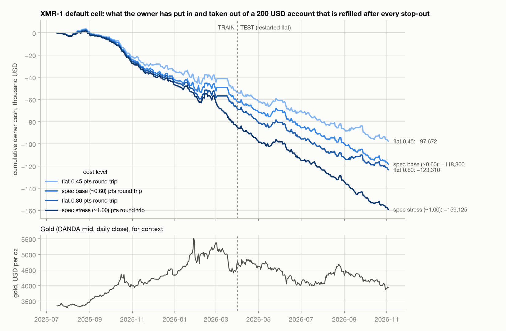
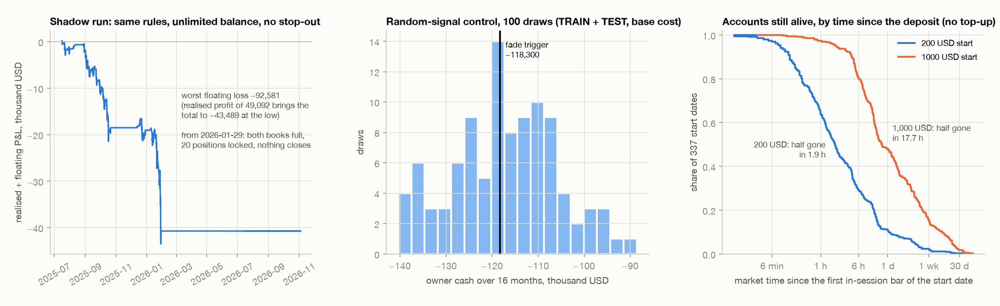

# XMR-1 "deposit-as-stop averaging fade" — backtest report

Candidate 1 of `analysis/STRATEGY_SPEC.md` (section 6), run exactly as pre-registered. Written 2026-11-11.
Evidence: `xmr1.py` (single-file event-driven M1 backtester, deterministic, about half a minute end to end), `report.py`
(this file and both figures; every result is read from `results/`, nothing is typed in).

**Verdict: FAIL.** It is a risk exhibit, was never a deployment candidate, and nothing here changes that.
The pre-registered hypothesis is confirmed on both counts: the default cell wins 80.4% (TRAIN) and 82.5% (TEST)
of its positions, a random signal wins the same share, and the owner's cash over the 16 months is −118,300 USD at
base cost and −159,125 USD at stress cost.

Units: 1 point = 1 USD per oz; 0.04 lots = 4 USD per point. All times UTC. "Owner cash" = withdrawals + final equity − deposits.

---

## 1. The short version

| Question | Answer (default cell: TP 1.0 × ATR5 per leg, sweep to 200 USD; spec base cost) |
|---|---|
| Does it win often? | Yes. 81.5% of 23,913 positions over TRAIN + TEST, PF 0.76. Average win 23 USD, average loss −131 USD. |
| Does the owner make money? | No. 155,000 USD deposited, 36,258 USD withdrawn, owner cash **−118,300 USD** in 70 weeks (−1,690 per week). TRAIN −61,516, TEST −56,784. |
| How often does the account die? | 773 margin stop-outs in 70 weeks: 11.0 per week, at least one in 87.1% of weeks. Only 5.4% (TRAIN) and 6.2% (TEST) of the 200 USD deposits were paid back by withdrawals before they were lost. |
| Is any cell or cost level positive? | No. 64 of 64 runs (8 cells × 4 cost levels × TRAIN and TEST) have negative owner cash. |
| Does the fade trigger matter? | No. Against 100 random-signal draws with the same firing rate per UTC hour and month, the trigger's 16-month owner cash sits at the 44th percentile at base cost and the 60th at stress. Nothing favours the trigger on any measure. |
| What does the stop-out hide? | With unlimited balance the same rules carry a floating loss of −92,581 USD at worst, one position 2,329 points under water, and the book is under water for 475 days — from the first weeks to the end of the data. |
| How long does a deposit last? | 200 USD: half of 337 start dates are stopped out within 1.9 hours and 89.0% within a day. 1,000 USD: half within 17.7 hours, 84.0% within a week, all within 90 days. |
| Does it reproduce his week? | Only in shape. In his active span the default cell opens 486 positions (he opened 178), is stopped out 21 times (7), wins 74.3% (75.8%) and loses 3,824 USD of owner cash (his trading net was +490.83). 41.1% of his 124 decisions have a simulated same-side order within ±5 minutes, against 21.4% by chance. |

---

## 2. What was run

**Rules** (spec 5 and 6, nothing added): two independent books; a fresh entry of 2 × 0.04 lots when the fade trigger is on
(5-bar return ≥ 0.6 × M5 ATR(14) into the outer third of the 15-bar range, ATR5 ≥ 3.0); one more 0.04-lot clip each time price
is max(0.7 × ATR5, 2.0) beyond the last open fill, up to 10 per side; a take-profit on every leg (max(TP_ATR × ATR5, 3.0));
no stop, no time exit; session 01:00–21:00 UTC Mon–Fri; a 200 USD account at 1:1000 whose 20% margin stop-out is the only
loss exit and sets the balance to 0; re-deposit 200 USD 60 minutes later; optional sweep of everything above 200 USD when flat.

**Data.** 469,227 M1 bars, 2025-07-16 06:17 to 2026-11-11 13:43: OANDA mid to 2026-07-15, OANDA bid/ask from 2026-07-16
(378 overlapping bars, largest close difference 0.00).

| Window | Bars | In-session bars | Bars passing the gap guard and ATR5 ≥ 3.0 | SELL trigger on | BUY trigger on | Median ATR5 |
|---|---:|---:|---:|---:|---:|---:|
| TRAIN 2025-07-16 to 2026-03-31 | 250,460 | 218,650 | 71.8% | 9.9% | 9.0% | 4.35 |
| TEST 2026-04-01 to 2026-11-03 | 211,063 | 184,024 | 94.8% | 12.3% | 12.8% | 4.77 |
| WEEK 2026-11-04 to 2026-11-11 | 7,704 | 6,765 | 97.6% | 13.5% | 12.4% | 4.70 |

TRAIN and TEST are separate simulations, each started flat with one 200 USD deposit; "FULL" is the two laid end to end.

**Costs.** Four levels, all reported. *Spec base*: XM bid = OANDA bid − 0.05 and ask = OANDA ask + 0.06 on quote data, mid ± 0.30 before
2026-07-16. *Spec stress*: a further 0.20 per side on quotes, mid ± 0.50 on mid data. *Flat 0.45* and *flat 0.80*: mid ± half of that
on the whole series (the house convention asked for in the brief). Median OANDA M1 spread in the quote file is 0.52.

**Basis, measured here before anything else.** XM deal price minus the OANDA same-side quote in the 5-second bar that contains
the deal: sells at the bid median -0.042 (n=159, 5th–95th percentile -0.44 to +0.52),
buys at the ask median +0.054 (n=162, -0.65 to +0.43), stop-outs excluded.
That reproduces the −0.05 / +0.06 the specification fixed, so those are used. The 34 stop-out deals filled a median -0.75 and a 5th
percentile of -23.2 points from OANDA's quote, which is why a stop-out is modelled as the loss of the whole balance and not as a fill price.

**Two places where the brief and the specification differ; the specification was followed and the brief's version is also shown.**
1. Split: the brief says first 60% / last 40%. The specification pre-registered dates (TRAIN to 2026-03-31, TEST from 2026-04-01),
   which is 54% / 46% of the bars. The dates were used.
2. Costs: the brief asks for 0.45 and 0.80 round trip; the specification for base and stress as above. All four are in every table that matters.

---

## 3. Harness checks (all passed before any result was read)

| Check | Result |
|---|---|
| Entry bar strictly after the signal bar | Asserted on every order in every run (`simulate`), never tripped |
| Closed-bar probe: (last M5 open + 5 min) − c(t) never positive | Maximum 0 s over all 469,227 bars |
| No data stamped after t is used at t | Every bar after a random cut scrambled, indicators recomputed, 24 cuts on 60,000 bars: signals, ATR5 and session flag at or before the cut are bit-identical; the test also asserts the scramble does change later values, so it is not vacuous |
| Trigger parity with the specification (check 3 of 9.2) | Trigger on at the last closed bar for 11 of 27 fresh entries and 39 of 124 decisions — exactly the 11 of 27 and 39 of 124 required |
| Engine self-test | Six synthetic cases: fill at next open, TP filled at the level, stop-out beats a TP in the same bar, re-deposit exactly 60 minutes later, add spacing and shared TP, margin rule, shadow mode, sub-bar resolution |
| Independent audit of the trade list | Every entry price equals the open of its bar, every TP was reachable in its bar, every stop-out mark is a bar extreme — re-checked from the bars for all 64 grid runs |
| Cash identity | Owner cash = position P&L + loss absorbed by the broker − equity forfeited at stop-out, asserted in every run |
| Fair-game test | On a driftless ±0.1-tick random walk (24 seeds × 150,000 bars) the owner's mean cash is −994 ± 1,363 (s.e.) at zero spread, inside the band −2,500 to 0 that the forfeited stop-out equity allows; at a 0.6 spread it is −13,984 ± 2,748 against −16,305 to −12,282. The engine neither creates nor destroys money. On that walk the same rules still win 87.8% of positions |
| Win rate near 0% or 100% | Not seen in the account runs (52%–86%). The shadow run's 97–99% is the expected artefact of never closing a loser and is reported as such |

---

## 4. Results

### 4.1 Default cell, all four cost levels

| window · cost | positions | win rate | PF | net points | position P&L USD | owner cash USD | wipe-outs | max DD USD | worst day USD | months > 0 | weeks > 0 |
|---|---:|---:|---:|---:|---:|---:|---:|---:|---:|---:|---:|
| TRAIN · flat 0.45 | 11,068 | 81.7% | 0.78 | −15,507 | −62,028 | −53,447 | 365 | 57,036 | −5,697 | 2 of 9 | 8 of 38 |
| TRAIN · spec base (~0.60) | 11,451 | 80.4% | 0.76 | −17,693 | −70,771 | −61,516 | 404 | 64,395 | −5,695 | 2 of 9 | 6 of 38 |
| TRAIN · flat 0.80 | 11,150 | 78.7% | 0.73 | −19,701 | −78,805 | −67,750 | 435 | 70,167 | −4,343 | 2 of 9 | 7 of 38 |
| TRAIN · spec stress (~1.00) | 11,837 | 76.7% | 0.70 | −24,480 | −97,920 | −84,620 | 527 | 86,303 | −4,343 | 1 of 9 | 5 of 38 |
| TEST · flat 0.45 | 11,411 | 84.4% | 0.80 | −13,033 | −52,132 | −44,225 | 294 | 45,685 | −5,340 | 0 of 8 | 10 of 32 |
| TEST · spec base (~0.60) | 12,462 | 82.5% | 0.76 | −16,677 | −66,707 | −56,784 | 369 | 58,050 | −4,261 | 1 of 8 | 5 of 32 |
| TEST · flat 0.80 | 11,292 | 82.7% | 0.76 | −15,919 | −63,676 | −55,560 | 337 | 56,360 | −4,801 | 0 of 8 | 6 of 32 |
| TEST · spec stress (~1.00) | 12,057 | 78.9% | 0.70 | −21,360 | −85,438 | −74,505 | 445 | 75,217 | −3,866 | 0 of 8 | 5 of 32 |
| FULL · flat 0.45 | 22,479 | 83.1% | 0.79 | −28,540 | −114,160 | −97,672 | 659 | 101,261 | −5,697 | 2 of 17 | 18 of 70 |
| FULL · spec base (~0.60) | 23,913 | 81.5% | 0.76 | −34,369 | −137,477 | −118,300 | 773 | 121,179 | −5,695 | 3 of 17 | 11 of 70 |
| FULL · flat 0.80 | 22,442 | 80.7% | 0.74 | −35,620 | −142,481 | −123,310 | 772 | 125,727 | −4,801 | 2 of 17 | 13 of 70 |
| FULL · spec stress (~1.00) | 23,894 | 77.8% | 0.70 | −45,840 | −183,358 | −159,125 | 972 | 160,808 | −4,343 | 1 of 17 | 10 of 70 |

Notes. "Position P&L" marks stop-out legs at the worst price of the stop-out bar, so it includes losses the account could not pay;
"owner cash" is what the owner actually put in and took out. They differ by the loss absorbed by the broker
(22,854 USD over the 16 months at base cost — an upper bound, it assumes liquidation at the bar's extreme) less the equity
forfeited at stop-out (3,676 USD). Max DD is peak-to-trough of cumulative owner cash, with the peak floored at the start.
Months: 9 in TRAIN (July 2025 is a half month), 8 in TEST (November 2026 is three days).

Where the money went, base cost: of the 118,300 USD lost, 58,349 USD is quoted spread on 23,913 positions and
3,676 USD is equity forfeited at stop-outs. The remaining 56,275 USD is price path: adds made
against moves that kept going. Against the fair-game walk above (whose spread of outcomes is wide: s.d. 13,464 USD per 150,000 bars)
that residual is 1.9 s.d. below expectation in TRAIN and 1.5 s.d. below in TEST. It points the same way as the S5 programme's finding that gold tends
to continue after a stretch, but the walk has constant volatility and real gold does not, so those s.d. figures overstate the evidence. I would not call it established.

### 4.2 The pre-registered grid (8 cells), TRAIN and TEST

| cost · cell | TRAIN owner cash | wipe-outs | positions | win rate | PF | time hedged | TEST owner cash | wipe-outs | positions | win rate | PF | time hedged |
|---|---:|---:|---:|---:|---:|---:|---:|---:|---:|---:|---:|---:|
| base · TP 1.0 · per_leg · sweep on | −61,516 | 404 | 11,451 | 80.4% | 0.76 | 50.3% | −56,784 | 369 | 12,462 | 82.5% | 0.76 | 60.4% |
| base · TP 1.0 · per_leg · sweep off | −66,558 | 333 | 11,501 | 82.8% | 0.76 | 57.0% | −58,800 | 294 | 12,017 | 84.2% | 0.76 | 64.5% |
| base · TP 1.0 · shared_first · sweep on | −71,571 | 514 | 8,592 | 68.3% | 0.74 | 43.5% | −25,782 | 188 | 4,028 | 74.2% | 0.81 | 80.8% |
| base · TP 1.0 · shared_first · sweep off | −62,600 | 313 | 6,391 | 71.4% | 0.75 | 59.2% | −34,050 | 188 | 4,611 | 75.3% | 0.78 | 78.8% |
| base · TP 2.5 · per_leg · sweep on | −61,350 | 317 | 5,793 | 66.6% | 0.77 | 72.1% | −31,500 | 176 | 4,340 | 73.0% | 0.83 | 86.7% |
| base · TP 2.5 · per_leg · sweep off | −62,244 | 311 | 5,757 | 66.9% | 0.77 | 72.3% | −32,623 | 172 | 4,316 | 73.3% | 0.83 | 86.9% |
| base · TP 2.5 · shared_first · sweep on | −61,381 | 319 | 4,520 | 57.6% | 0.78 | 71.0% | −14,492 | 78 | 1,696 | 70.4% | 0.87 | 93.1% |
| base · TP 2.5 · shared_first · sweep off | −62,400 | 312 | 4,483 | 57.9% | 0.78 | 71.3% | −15,375 | 79 | 1,703 | 70.2% | 0.86 | 93.0% |
| 0.80 · TP 1.0 · per_leg · sweep on | −67,750 | 435 | 11,150 | 78.7% | 0.73 | 49.3% | −55,560 | 337 | 11,292 | 82.7% | 0.76 | 64.9% |
| 0.80 · TP 1.0 · per_leg · sweep off | −72,560 | 363 | 11,194 | 81.1% | 0.73 | 56.3% | −51,400 | 257 | 10,874 | 85.0% | 0.76 | 69.4% |
| 0.80 · TP 1.0 · shared_first · sweep on | −55,618 | 390 | 6,812 | 69.2% | 0.76 | 52.4% | −32,200 | 234 | 5,305 | 74.7% | 0.81 | 75.4% |
| 0.80 · TP 1.0 · shared_first · sweep off | −64,200 | 321 | 6,462 | 70.9% | 0.75 | 59.4% | −52,434 | 280 | 6,613 | 73.8% | 0.75 | 69.5% |
| 0.80 · TP 2.5 · per_leg · sweep on | −65,262 | 340 | 5,936 | 64.9% | 0.76 | 70.2% | −32,750 | 184 | 4,308 | 72.0% | 0.82 | 86.4% |
| 0.80 · TP 2.5 · per_leg · sweep off | −65,848 | 329 | 5,905 | 65.6% | 0.76 | 70.7% | −34,200 | 180 | 4,295 | 72.3% | 0.82 | 86.5% |
| 0.80 · TP 2.5 · shared_first · sweep on | −61,261 | 322 | 4,488 | 57.6% | 0.78 | 72.4% | −13,968 | 75 | 1,683 | 70.9% | 0.89 | 93.1% |
| 0.80 · TP 2.5 · shared_first · sweep off | −62,400 | 312 | 4,404 | 57.7% | 0.78 | 72.8% | −14,851 | 76 | 1,691 | 70.7% | 0.88 | 93.1% |
| stress · TP 1.0 · per_leg · sweep on | −84,620 | 527 | 11,837 | 76.7% | 0.70 | 44.5% | −74,505 | 445 | 12,057 | 78.9% | 0.70 | 57.3% |
| stress · TP 1.0 · per_leg · sweep off | −80,163 | 401 | 11,507 | 80.0% | 0.72 | 52.8% | −72,000 | 360 | 11,838 | 81.3% | 0.71 | 61.9% |
| stress · TP 1.0 · shared_first · sweep on | −57,656 | 392 | 6,801 | 68.9% | 0.76 | 52.4% | −53,178 | 326 | 6,239 | 70.5% | 0.74 | 69.4% |
| stress · TP 1.0 · shared_first · sweep off | −60,000 | 300 | 5,888 | 70.7% | 0.75 | 61.7% | −52,698 | 280 | 6,206 | 72.7% | 0.74 | 70.6% |
| stress · TP 2.5 · per_leg · sweep on | −65,753 | 342 | 5,825 | 64.6% | 0.76 | 70.3% | −56,200 | 297 | 5,816 | 67.3% | 0.77 | 79.6% |
| stress · TP 2.5 · per_leg · sweep off | −66,652 | 333 | 5,804 | 65.1% | 0.75 | 70.6% | −55,938 | 281 | 5,776 | 68.2% | 0.78 | 80.4% |
| stress · TP 2.5 · shared_first · sweep on | −65,236 | 345 | 4,608 | 56.0% | 0.76 | 70.8% | −756 | 23 | 669 | 75.2% | 0.98 | 97.4% |
| stress · TP 2.5 · shared_first · sweep off | −67,800 | 339 | 4,587 | 56.2% | 0.76 | 71.0% | −1,560 | 24 | 677 | 74.4% | 0.97 | 97.3% |

Every cell loses in both windows at every cost level. The flat stretches in the equity figure are the same thing seen from the default cell. The cells that lose least are the ones that trade least: with the larger target and
a shared target the two books spend most of the time locked against each other ("time hedged" = both books open at the bar close), fresh
entries stop, and the account sits on a frozen loss instead of realising it. That is the hedge-lock he used by hand; here it is a by-product
of two independent books on a net-margin account. It lowers turnover; it does not turn the result positive: the least-bad run in the table (TEST, stress, TP 2.5, shared target) had both
books open 97.4% of the time and opened 669 positions in seven months, and the same cell lost 14,492 USD at base cost. On TRAIN the
differences between cells are within the spread of the random control (s.d. about 7,752 USD), so the ranking of cells carries no information.

### 4.3 Wipe-outs (default cell)

| | TRAIN base | TEST base | TRAIN stress | TEST stress |
|---|---:|---:|---:|---:|
| Margin stop-outs | 404 | 369 | 527 | 445 |
| Per week (mean) | 10.6 | 11.5 | 13.9 | 13.9 |
| Most in one week | 35 | 24 | 38 | 26 |
| Weeks with at least one | 81.6% | 93.8% | 86.8% | 93.8% |
| Calendar days with at least one | 53.6% | 56.8% | 61.7% | 61.6% |
| Owner cash per 200 USD deposit, USD | −152 | −153 | −160 | −167 |
| Balance wiped per stop-out, USD: median / mean / largest | 347 / 707 / 25,428 | 382 / 735 / 16,464 | 339 / 586 / 20,874 | 350 / 613 / 14,183 |
| Longest run of stop-outs with no withdrawal between | 20 | 11 | 24 | 14 |
| Deposits paid back by withdrawals before the stop-out | 5.4% | 6.2% | 5.1% | 4.7% |
| Median withdrawn per deposit, USD | 0 | 0 | 0 | 0 |
| Loss absorbed by the broker (upper bound), USD | 11,024 | 11,829 | 15,705 | 13,156 |
| Positions closed by stop-out | 2,245 of 11,451 | 2,187 of 12,462 | 2,762 of 11,837 | 2,562 of 12,057 |
| Time flat (both books empty) | 20.8% | 14.5% | 25.5% | 17.0% |
| Time with both books open | 50.3% | 60.4% | 44.5% | 57.3% |
| Most positions open / largest net lots | 20 / 0.40 | 20 / 0.40 | 20 / 0.40 | 20 / 0.40 |
| Orders refused by the margin rule | 861 | 819 | 1,064 | 1,105 |
| Median position hold, minutes | 26 | 27 | 27 | 30 |

"Balance wiped" is the realised balance at the stop-out, not what the owner lost on that deposit: it is the deposit plus take-profit income that
could not be swept because the two books were never empty together, and by the time of the stop-out the open losers had already consumed it. The
largest one (TRAIN, 2026-03-19 07:44, 25,428 USD of balance, 10 longs and 0 shorts open) ended a month in which 10 shorts opened on 2026-02-18
sat under water while the long book kept taking profits; both books then sat full and locked from 2026-03-03 until the shorts reached their
targets on 2026-03-18, and the longs were stopped out the next morning. That is the flat stretch in the equity figure (`results/trades_default_base.csv`, `wipeouts_default.csv`).

### 4.4 Owner cash per week and per month (default cell)

Per week, base cost, 70 weeks: mean −1,690, median −1,811, best 7,533, worst −6,489,
5th–95th percentile −5,297 to 2,158. 11 weeks (15.7%) are positive and
11 (15.7%) are at least as good as his +491 USD trading week; 9 (12.9%) reach his +920 USD of cash.
A week like his is roughly a one-in-six to one-in-eight event for a machine that loses
1,690 USD in the average week. The full weekly series for every cell is in `results/weekly_owner_cash.csv`.

| month | flat 0.45 | spec base | flat 0.80 | spec stress |
|---|---:|---:|---:|---:|
| 2025-07 | −2,115 | −2,095 | −2,099 | −2,489 |
| 2025-08 | 3,571 | 2,880 | 2,386 | 2,030 |
| 2025-09 | −6,622 | −6,654 | −7,098 | −7,316 |
| 2025-10 | −16,521 | −18,404 | −18,889 | −19,441 |
| 2025-11 | −7,254 | −8,791 | −9,512 | −9,832 |
| 2025-12 | −5,612 | −9,163 | −9,009 | −9,750 |
| 2026-01 | −9,365 | −9,145 | −10,225 | −10,789 |
| 2026-02 | 3,849 | 3,397 | 237 | −944 |
| 2026-03 | −13,378 | −13,541 | −13,542 | −26,089 |
| 2026-04 | −7,343 | −8,903 | −12,091 | −12,451 |
| 2026-05 | −27 | 496 | −783 | −1,114 |
| 2026-06 | −9,618 | −14,750 | −14,173 | −15,857 |
| 2026-07 | −10,249 | −8,492 | −9,771 | −9,464 |
| 2026-08 | −5,792 | −6,106 | −7,328 | −9,879 |
| 2026-09 | −3,467 | −9,261 | −3,885 | −13,944 |
| 2026-10 | −6,133 | −7,811 | −5,509 | −9,755 |
| 2026-11 | −1,596 | −1,957 | −2,020 | −2,039 |

### 4.5 Random-signal control (100 draws)

Same machine, same costs, same adds, targets and account; the trigger is replaced by a random signal placed on in-session bars that pass the
same gap and ATR5 ≥ 3.0 guards, with exactly the trigger's own count per calendar month and UTC hour, per side (so volatility and price regime are matched).

| window · cost | trigger owner cash | control mean | control 5th–95th pct | trigger's percentile | trigger wipe-outs | control wipe-outs (mean) | trigger positions | control positions (mean) |
|---|---:|---:|---:|---:|---:|---:|---:|---:|
| TRAIN · base | −61,516 | −62,490 | −74,432 to −51,035 | 54th | 404 | 394 | 11,451 | 12,949 |
| TRAIN · stress | −84,620 | −82,903 | −95,688 to −69,155 | 39th | 527 | 498 | 11,837 | 13,396 |
| TEST · base | −56,784 | −54,694 | −66,160 to −38,730 | 47th | 369 | 321 | 12,462 | 12,297 |
| TEST · stress | −74,505 | −77,638 | −86,727 to −63,626 | 79th | 445 | 437 | 12,057 | 13,197 |
| TRAIN+TEST · base | −118,300 | −117,184 | −136,218 to −97,506 | 44th | 773 |  | 23,913 |  |
| TRAIN+TEST · stress | −159,125 | −160,541 | −177,091 to −141,520 | 60th | 972 |  | 23,894 |  |

| window · cost | trigger win rate | control mean | control 5th–95th pct | trigger's percentile | trigger PF | control mean | control 5th–95th pct | trigger's percentile |
|---|---:|---:|---:|---:|---:|---:|---:|---:|
| TRAIN · base | 80.4% | 81.7% | 80.4% to 83.2% | 6th | 0.761 | 0.786 | 0.762 to 0.811 | 5th |
| TRAIN · stress | 76.7% | 78.2% | 76.8% to 79.9% | 4th | 0.697 | 0.738 | 0.715 to 0.766 | below every draw |
| TEST · base | 82.5% | 82.9% | 81.5% to 84.5% | 38th | 0.764 | 0.777 | 0.758 to 0.802 | 19th |
| TEST · stress | 78.9% | 79.2% | 78.1% to 80.3% | 36th | 0.701 | 0.719 | 0.703 to 0.734 | 2nd |

On owner cash the trigger is inside the control's 5th–95th percentile range in all four window/cost pairs and near its middle over the 16 months.
Position PF and win rate sit low in the control's range (PF percentile, in table order: 5th, below every draw, 19th, 2nd).
That is turnover, not money. Random timing re-enters sooner and opens +13%, +13%, -1% and +9% positions relative to the trigger for the same net result:
total position P&L is within 0.4 s.d. of the control mean in all four pairs. More gross profit and more gross loss around the same
net pulls a ratio like PF toward 1; the gap is largest where the turnover gap is largest and nearly gone where it is not (TEST base). I tested two
other explanations and both failed: the loss absorbed by the broker is not larger for the trigger, and ATR5 at trigger bars equals ATR5 at
control bars (6.99 against 6.97 in TRAIN, 5.31 against 5.33 in TEST; `results/qa.json`). So the fade trigger does not help on any measure, and there is no
evidence here that it hurts. The win rate, the losses and the wipe-outs are produced by the exit shape, the averaging and the account, not by the entry.

### 4.6 Shadow run — unlimited balance, no stop-out

One continuous run over TRAIN + TEST (2025-07-16 to 2026-11-03), margin rule off.

| cell · cost | positions | win rate | realised USD | floating at end USD | total USD | worst floating USD | on | worst single position, pts | longest under water, days | longest position, days | max positions |
|---|---:|---:|---:|---:|---:|---:|---:|---:|---:|---:|---:|
| TP 1.0 · per_leg · base | 2,485 | 99.2% | 48,378 | −89,315 | −40,937 | −92,581 | 2026-01-28 | 2,329 | 475 | 461 | 20 |
| TP 1.0 · per_leg · stress | 2,290 | 99.1% | 44,970 | −89,348 | −44,378 | −92,597 | 2026-01-28 | 2,329 | 475 | 461 | 20 |
| TP 2.5 · per_leg · base | 1,134 | 98.2% | 53,710 | −89,638 | −35,928 | −92,485 | 2026-01-28 | 2,328 | 475 | 461 | 20 |
| TP 2.5 · per_leg · stress | 1,064 | 98.1% | 51,523 | −89,670 | −38,146 | −92,501 | 2026-01-28 | 2,328 | 475 | 461 | 20 |
| TP 1.0 · shared_first · base | 1,069 | 98.1% | 53,580 | −88,947 | −35,367 | −92,450 | 2026-01-28 | 2,329 | 471 | 461 | 20 |
| TP 1.0 · shared_first · stress | 1,034 | 98.1% | 53,029 | −88,979 | −35,949 | −92,466 | 2026-01-28 | 2,329 | 471 | 461 | 20 |
| TP 2.5 · shared_first · base | 673 | 97.0% | 57,771 | −89,465 | −31,694 | −92,442 | 2026-01-28 | 2,328 | 431 | 461 | 20 |
| TP 2.5 · shared_first · stress | 639 | 96.9% | 55,176 | −89,497 | −34,320 | −92,458 | 2026-01-28 | 2,328 | 432 | 461 | 20 |

Measured from `results/shadow_open_positions.csv`: the short book fills to ten clips between 2025-07-30 and 2025-08-01 at 3,274–3,300,
and gold then rises for six months; the long book fills to ten on 2026-01-29 at 5,443–5,570, on the way down from the high (the worst floating loss is stamped 2026-01-28 23:40). The last order
of the whole run is opened at 2026-01-29 15:07. After that both books are full, nothing more can be opened, and the "strategy" is 20
positions that never close, for the remaining nine months. The 97–99%
win rate is what is left when losers are never booked: 48,378 USD realised against −89,315 USD still open. The worst floating loss is
463 times the 200 USD deposit. This is the tail the margin stop-out cuts off and bills in 200 USD instalments instead.

### 4.7 Time to ruin from rolling start dates (default cell, base cost, no top-up)

One account opened at the first in-session bar of each of 337 trading days and run until its first margin stop-out or the end of TEST.

| start · sweep | starts | stopped out | median hours to stop-out | 90th pct hours | within 1 day | within 1 week | within 30 days | within 90 days | longest survivor, days | mean owner cash USD | starts where the owner came out ahead |
|---|---:|---:|---:|---:|---:|---:|---:|---:|---:|---:|---:|
| 200 USD · sweep off | 337 | 336 | 2.5 | 40 | 85.1% | 95.8% | 99.4% | 100.0% (n=273) | 38 | −193 | 0.3% |
| 200 USD · sweep on | 337 | 336 | 1.9 | 25 | 89.0% | 97.6% | 99.7% | 100.0% (n=273) | 35 | −123 | 7.1% |
| 1000 USD · sweep off | 337 | 334 | 19.2 | 274 | 51.2% | 83.7% | 97.8% | 100.0% (n=273) | 57 | −972 | 0.9% |
| 1000 USD · sweep on | 337 | 334 | 17.7 | 274 | 51.8% | 84.0% | 98.1% | 100.0% (n=273) | 57 | −874 | 3.3% |

"Within N" uses only start dates with at least N of data left. The few accounts not stopped out are the last start dates, cut off by the end of
the data. With the sweep on, the owner came out ahead (withdrew more than the deposit before the stop-out) from 7.1% of 200 USD starts
and 3.3% of 1,000 USD starts. A five-times larger account at the same clip buys about nine times the median life and the same ending.

### 4.8 Trade week, 2026-11-04 10:06 to 2026-11-11 07:04 (parity only, never part of a verdict)

| | Real account | XMR-1 default, base, M1 exits | same, S5 exits | XMR-1 default, stress, M1 | same, S5 exits |
|---|---:|---:|---:|---:|---:|
| Positions opened | 178 | 486 | 487 | 448 | 448 |
| Position win rate | 75.8% | 74.3% | 74.7% | 71.4% | 71.7% |
| PF | 1.13 | 0.58 | 0.63 | 0.57 | 0.60 |
| Average win / loss, USD | 31.5 / -96.5 | 19.1 / -94.3 | 19.1 / -89.2 | 19.8 / -87.2 | 19.8 / -83.3 |
| Margin stop-outs | 7 | 21 | 21 | 23 | 23 |
| Positions closed by stop-out | 34 (19.1%) | 122 (25.1%) | 120 (24.6%) | 126 (28.1%) | 125 (27.9%) |
| Time flat | 17.4% | 26.6% | 26.6% | 25.3% | 25.3% |
| Median hold, minutes | 30.5 | 22.5 | 22.0 | 26.0 | 26.0 |
| Deposits / withdrawals, USD | 884.74 / 1,805.00 | 4,400 / 413 | 4,400 / 473 | 4,800 / 755 | 4,800 / 755 |
| Result, USD | trading net +490.83; cash +920.26 (379.15 of it broker money) | owner cash −3,824 | −3,764 | −3,889 | −3,889 |

Reading. Same order of magnitude, as expected, and the mix per position is close (about three in four win; a fifth of his positions and a
quarter of the machine's end in a stop-out). The machine is 2.7 times as active as he was — it re-enters the moment a book is empty and the trigger is on, he opened
about 4.5 fresh baskets a day — and it is stopped out 3 times as often. It does **not** reproduce his result: he ended the week up, the
machine ended it 3,824 USD down. Six days cannot say whether that gap is his discretion (closing winners by hand, pausing,
choosing when to add) or luck; section 4.4 puts a week like his at about one in six to one in eight for the machine.

**S5 against M1 exits.** Resolving stop-outs and targets on 5-second bid/ask bars (the M1 rule "stop-out before any target in the bar" is then
applied inside 5 seconds instead of 60) changes owner cash from −3,824 to −3,764 at base cost (60 USD,
1.6%) and from −3,889 to −3,889 at stress. Wipe-out counts are identical. The M1 tie rule is slightly conservative and does not drive any conclusion.
What does change is the loss marked beyond zero equity: 1,171 USD on M1 against 430 USD on S5, which confirms "loss absorbed by the broker" on M1 is an upper bound.

All eight cells in the same span, M1 exits:

| cost · cell | owner cash | deposits | withdrawals | wipe-outs | positions | win rate | PF | time flat | time hedged | max positions | median hold, min |
|---|---:|---:|---:|---:|---:|---:|---:|---:|---:|---:|---:|
| base · TP 1.0 · per_leg · sweep on | −3,824 | 4,400 | 413 | 21 | 486 | 74.3% | 0.58 | 26.6% | 38.2% | 12 | 22 |
| base · TP 1.0 · per_leg · sweep off | −2,837 | 3,000 | 0 | 14 | 479 | 79.5% | 0.67 | 17.7% | 47.7% | 13 | 25 |
| base · TP 1.0 · shared_first · sweep on | −3,208 | 3,800 | 429 | 18 | 351 | 68.9% | 0.64 | 21.2% | 46.2% | 16 | 37 |
| base · TP 1.0 · shared_first · sweep off | −3,437 | 3,600 | 0 | 17 | 350 | 69.4% | 0.63 | 18.9% | 47.5% | 16 | 45 |
| base · TP 2.5 · per_leg · sweep on | 2,275 | 400 | 0 | 1 | 144 | 80.6% | 1.41 | 1.3% | 93.9% | 20 | 324 |
| base · TP 2.5 · per_leg · sweep off | 2,275 | 400 | 0 | 1 | 144 | 80.6% | 1.41 | 1.3% | 93.9% | 20 | 324 |
| base · TP 2.5 · shared_first · sweep on | −2,407 | 2,800 | 190 | 13 | 206 | 53.4% | 0.72 | 13.8% | 71.4% | 15 | 152 |
| base · TP 2.5 · shared_first · sweep off | −1,794 | 2,000 | 0 | 9 | 179 | 59.8% | 0.82 | 10.0% | 78.6% | 20 | 243 |
| stress · TP 1.0 · per_leg · sweep on | −3,889 | 4,800 | 755 | 23 | 448 | 71.4% | 0.57 | 25.3% | 40.8% | 12 | 26 |
| stress · TP 1.0 · per_leg · sweep off | −3,244 | 3,400 | 0 | 16 | 448 | 76.3% | 0.61 | 19.7% | 46.5% | 13 | 26 |
| stress · TP 1.0 · shared_first · sweep on | −3,227 | 4,400 | 1,017 | 21 | 375 | 66.7% | 0.64 | 24.7% | 43.2% | 15 | 45 |
| stress · TP 1.0 · shared_first · sweep off | −4,444 | 4,600 | 0 | 22 | 377 | 64.5% | 0.57 | 26.1% | 40.0% | 15 | 44 |
| stress · TP 2.5 · per_leg · sweep on | 2,626 | 400 | 0 | 1 | 142 | 80.3% | 1.52 | 1.3% | 94.1% | 20 | 317 |
| stress · TP 2.5 · per_leg · sweep off | 2,626 | 400 | 0 | 1 | 142 | 80.3% | 1.52 | 1.3% | 94.1% | 20 | 317 |
| stress · TP 2.5 · shared_first · sweep on | −2,804 | 3,000 | 0 | 14 | 202 | 52.0% | 0.69 | 14.0% | 71.5% | 15 | 168 |
| stress · TP 2.5 · shared_first · sweep off | −2,804 | 3,000 | 0 | 14 | 202 | 52.0% | 0.69 | 14.0% | 71.5% | 15 | 168 |

One cell (TP 2.5 × ATR, per leg) is positive in this week: both books filled to ten, locked against each other, and scalped the range for
five days with a single stop-out. That same cell lost 61,350 USD in TRAIN and 31,500 USD in TEST. It is the clearest picture in this report of how a
two-way range week flatters this method, and of how little one week says.

### 4.9 Replication — do the rules reproduce his entries?

Span 2026-11-04 10:06 to 2026-11-11 07:04. The simulation placed 372 orders (486 positions: 239 buys, 247 sells);
he made 124 decisions (178 positions: 74 buys, 104 sells). A match is the same side within ±5 minutes. Two chance
baselines: the same test against the opposite side, and against the other series shifted by ±67 to ±733 minutes (16 shifts; mean and maximum).

| Test | n | matched | rate | opposite side | time-shift placebo, mean | placebo, max |
|---|---:|---:|---:|---:|---:|---:|
| His 124 decisions with a simulated order within ±5 min, same side | 124 | 51 | 41.1% | 20.2% | 21.4% | 32.3% |
| His 27 fresh entries (flat book), same test | 27 | 11 | 40.7% | 18.5% | 20.1% | 33.3% |
| His 178 positions, same test | 178 | 62 | 34.8% | 24.7% | 19.4% | 37.6% |
| His 124 decisions with the raw trigger on within ±5 min, same side | 124 | 78 | 62.9% | 33.1% | 34.9% | 46.0% |
| Simulated orders with one of his decisions within ±5 min, same side | 372 | 66 | 17.7% | 8.1% | 8.0% | 12.1% |

The rules explain about four in ten of his decisions, roughly twice the chance rate, so about two in ten beyond coincidence. Going the other
way, more than eight in ten of the machine's orders have no counterpart in his trading. The trigger-parity figure from the specification
(trigger on at the last closed bar for 11 of 27 fresh entries and 39 of 124 decisions) is reproduced exactly by this harness. The fade is a
tendency in what he does; these rules are not a replica of him, and the book state of the simulation diverges from his within hours.

### 4.10 Secondary window, 2019-01-01 to 2025-07-15 (report only)

Long mid-only file `../../../m3_scalper/xau_m1_full.parquet`, spread 1.5 bp (base) and 2.5 bp (stress) of price. Quality check against the OANDA
file on their overlap: closes identical on 100.0% of shared bars, but 5,493 of 353,408 OANDA bars
(1.6%) are missing from it and some highs differ by up to 4.6 points. Usable for a secondary look, not for a verdict.

| cost · sweep | owner cash | deposits | withdrawals | wipe-outs | positions | win rate | PF | time flat | time hedged | weeks > 0 |
|---|---:|---:|---:|---:|---:|---:|---:|---:|---:|---:|
| base_1.5bp · sweep on | −40,878 | 109,000 | 67,373 | 544 | 16,964 | 79.1% | 0.80 | 75.1% | 8.4% | 30.1% |
| base_1.5bp · sweep off | −2,242 | 6,400 | 0 | 31 | 6,649 | 96.5% | 0.97 | 13.5% | 49.0% | 48.0% |
| stress_2.5bp · sweep on | −62,154 | 121,000 | 57,592 | 604 | 16,124 | 76.0% | 0.72 | 77.5% | 7.8% | 26.9% |
| stress_2.5bp · sweep off | −39,441 | 41,000 | 0 | 204 | 10,502 | 86.9% | 0.76 | 17.8% | 49.1% | 44.7% |

By year, default cell, base cost:

| year | owner cash | wipe-outs | in-session bars passing ATR5 ≥ 3.0 | median ATR5 | median price |
|---|---:|---:|---:|---:|---:|
| 2019 | −0 | 4 | 0.2% | 0.62 | 1,410 |
| 2020 | −3,331 | 93 | 9.5% | 1.39 | 1,775 |
| 2021 | 1,016 | 35 | 2.0% | 1.04 | 1,794 |
| 2022 | −3,726 | 39 | 3.2% | 1.14 | 1,805 |
| 2023 | −152 | 30 | 1.8% | 1.00 | 1,945 |
| 2024 | −5,538 | 124 | 8.1% | 1.48 | 2,381 |
| 2025 | −29,145 | 219 | 35.4% | 2.42 | 3,123 |

This window mostly tests the 3.0-point floors, not the method: gold's M5 ATR was 0.6–1.5 points before 2024, so the trigger is switched off
on 90–100% of bars and the account is idle. Where it does trade (2020, 2024, the first half of 2025) it loses. The fixed-point thresholds were
set from one week at 4,000 USD gold and do not transfer to earlier years (vault trap 8); no conclusion is drawn from this window beyond "no sign of a profit".

---

## 5. Protocol verdict

The default cell is the pre-registered hypothesis. For the brief's "choose on TRAIN, report TEST once": the cell with the best TRAIN owner cash
at base cost is TP 2.5 × ATR, per_leg, sweep on (−61,350 USD, ahead of the next cell by 31 USD — noise).
Its TEST result, once: owner cash −31,500 USD at base, −32,750 at 0.80; PF 0.83 and 0.82; 4,308 positions.

Bars from the brief, at 0.80 round-trip cost:

| cell | TEST PF ≥ 1.15 | positive in both halves | ≥ 60% of TEST months positive | no month > half of net | ≥ 200 TEST trades |
|---|---:|---:|---:|---:|---:|
| default (TP 1.0, per_leg, sweep on) | 0.76 — fail | TRAIN −67,750, TEST −55,560 — fail | 0 of 8 — fail | not applicable, net is negative — fail | 11,292 — met |
| TRAIN-selected (TP 2.5, per_leg, sweep on) | 0.82 — fail | TRAIN −65,262, TEST −32,750 — fail | 3 of 8 — fail | not applicable, net is negative — fail | 4,308 — met |

Four of five bars failed by both cells. **FAIL**, at every cost level, in both windows, in every cell. The specification set no pass mark for this
candidate; the verdict is recorded because the workflow asks for one.

---

## 6. What this does and does not show

Shown, with the sample to back it:
- The codified method — fade trigger, flat-clip averaging, a target on every leg, no stop, a 200 USD account at 1:1000 — loses the owner money
  in 64 of 64 runs across 16 months, two independent windows, eight cells and four cost levels, on 23,913 positions in the default cell.
- Its high win rate is geometry. A random signal gets the same win rate, wipe-out count and owner cash, and a coin-flip price
  series gives the same machine an 87.8% win rate.
- The margin stop-out is the stop, and it is an expensive one: 2.2 stop-outs per trading day, roughly 19 in 20 deposits lost
  before they pay themselves back, 153 USD lost per 200 USD deposited.
- Quoted spread explains about half of the loss (49%). The rest is price path.

Not shown:
- **That he would have lost this much.** The machine trades about three times as often as he did, has no discretion, and gets no bonus credit.
  It reproduces the shape of his week, not his result, and matches about 40% of his decisions. This is the long-run cost of the rules
  that could be written down, not a forecast of his account.
- **That his discretion has no value.** The behaviours left out (closing winners by hand at about half the target, pausing, hedge-locks, size-ups,
  top-ups) could not be codified. The earlier studies priced the size-ups and hedge-locks as losers (−1,652 and −249 USD), which is why leaving them out
  was expected to flatter this candidate. The hand-closing is unpriced in either direction.
- **Anything about a different regime.** 16 months of a strongly trending, high-volatility gold market (3,340 to above 5,600 and back to about 4,000).
  The trade week itself was a two-way range, the regime that suits the method; section 4.8 shows one cell making money in it.

Modelling limits that matter:
- Before 2026-07-16 the spread is assumed (0.60 base), not observed. The four cost levels bracket it and none changes the sign.
- OANDA is a proxy for XM. In calm bars the basis is about 0.05 points; at fast moves XM's stop-out fills were up to 23 points from OANDA's quote.
  The account model sidesteps this by treating a stop-out as the loss of the whole balance (his real stop-outs left 2.97 USD or less).
- Stop-outs are evaluated on M1 extremes with the stop-out ahead of any target in the bar. The S5 re-run on the trade week moves owner cash by under 2%.
- Re-deposit after exactly 60 minutes is an assumption (his were 0.2 to 12 hours). It sets how many deposits fit in a week, not what each one is worth.
- Rule 6 lets an order through whenever it reduces net lots, so the two books lock against each other for about half the time. That is the
  specification, and close to what he did under pressure, but it is far more hedging than he showed (22 of 124 decisions).
- Sample sizes are large for the machine (tens of thousands of positions, hundreds of stop-outs) and tiny for the man (six days). Every statement
  about the machine above is well supported; every comparison with him rests on one week.

---

## 7. Files

| File | What |
|---|---|
| `xmr1.py` | The backtester and every run. `python xmr1.py` runs all steps; `python xmr1.py selftest` runs the engine and look-ahead checks only |
| `report.py` | Builds this report and the two figures from `results/` |
| `equity_curve.png`, `exhibits.png` | Figures above |
| `results/grid.csv` | All 64 grid runs (8 cells × 4 cost levels × TRAIN, TEST), every metric |
| `results/wipeouts_default.csv`, `trades_default_base.csv` | Default cell: every stop-out (time, balance wiped, books) and every position at base cost |
| `results/daily_owner_cash.csv`, `weekly_owner_cash.csv`, `monthly_owner_cash.csv` | Owner cash per UTC day, week (Sun–Sat) and month for every run |
| `results/control.csv` | 400 random-signal runs (100 draws × 2 windows × 2 costs) |
| `results/shadow.csv`, `shadow_equity_*.csv` | Shadow run summary and hourly equity |
| `results/ruin.csv`, `ruin_summary.csv` | Rolling-start time to stop-out, 200 and 1,000 USD |
| `results/week.csv`, `week_sim_trades.csv`, `replication.json` | Trade-week runs (M1 and S5), the simulated trades, and the entry-matching test |
| `results/secondary.csv`, `secondary_by_year.csv` | 2019–2025 secondary window |
| `results/qa.json`, `null_random_walk.csv`, `null_summary.csv` | Data and harness checks, basis measurement, fair-game test |

Inputs were read only. No production system, box or broker API was touched. Nothing was committed and the vault was not updated.
